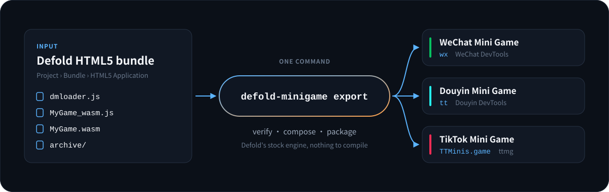
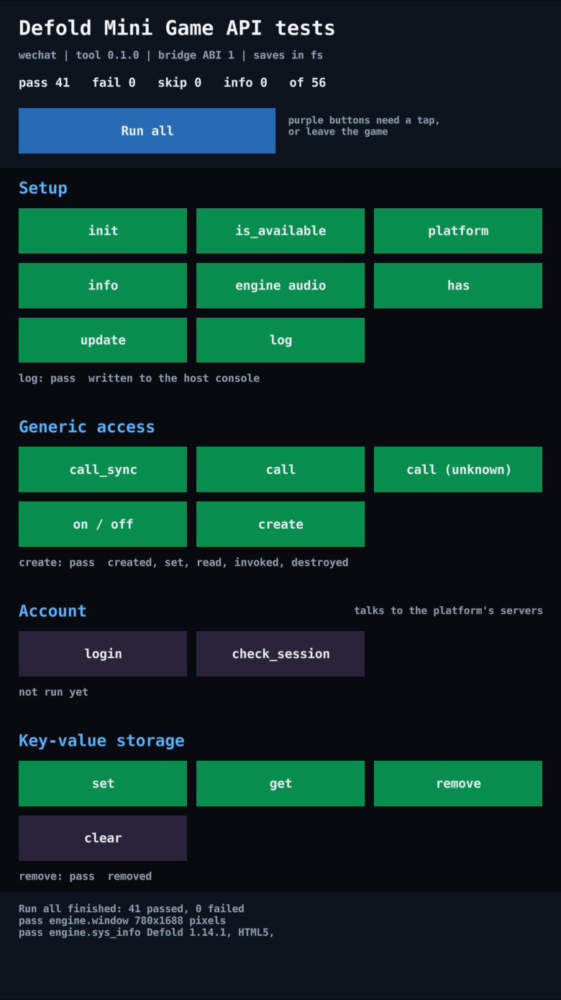
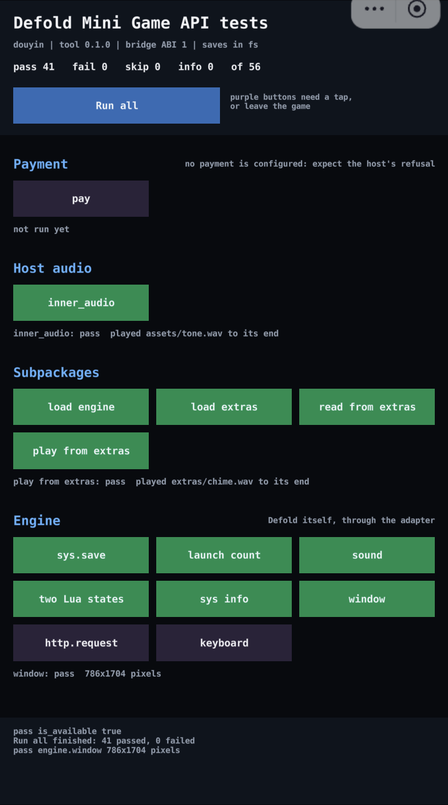
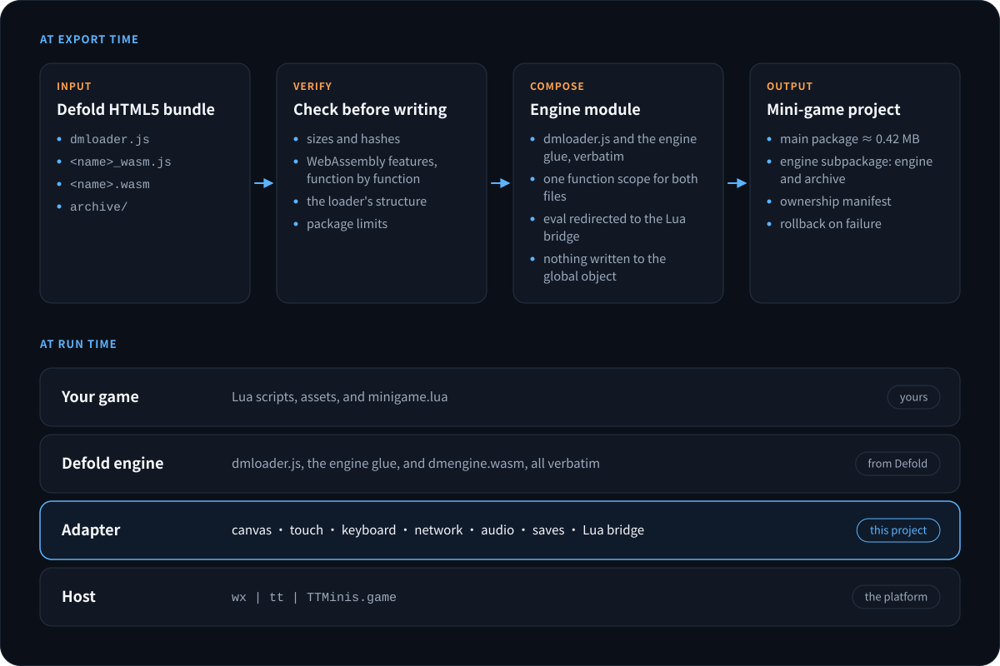
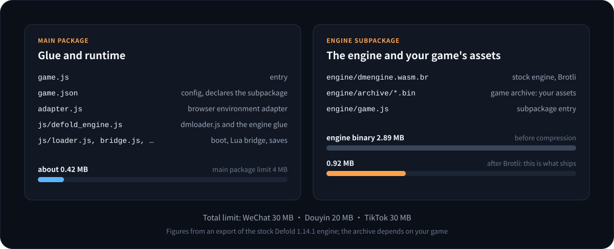

<h1 align="center">Defold Mini Game</h1>

<p align="center">
  <strong>Turn the HTML5 bundle Defold writes into a WeChat, Douyin, or TikTok mini-game project with one command.</strong>
</p>

<p align="center">
  <a href="docs/QUICK_START.md">Quick start</a> ·
  <a href="docs/USAGE.md">Usage guide</a> ·
  <a href="docs/API.md">Lua SDK</a> ·
  <a href="docs/ARCHITECTURE.md">Architecture</a> ·
  <a href="docs/RESEARCH_zh.md">Research and rationale (Chinese)</a> ·
  <a href="https://anrans.github.io/defold_for_minigame/en/">Website</a> ·
  <a href="README_zh.md">简体中文</a>
</p>

<p align="center">
  
</p>

> [!WARNING]
> **This is v0.1.0, an experimental release.**
> Verified: more than 200 automated tests, a static check against the stock Defold 1.14.0 and 1.14.1 engines, and the real engine running in the WeChat DevTools and Douyin DevTools simulators: start-up, rendering, touch, saves, sound, subpackages, and the Lua SDK.
> Not verified: TikTok's `ttmg dev`, and every real device. Pass the developer tool and a real device yourself before you ship. See [Validation status](#validation-status).

<p align="center">
  
  
</p>
<p align="center"><sub>Real screenshots: the API test app in this repository on Defold 1.14.1, in the WeChat DevTools simulator on the left and the Douyin DevTools simulator on the right. Green passed; purple needs a tap or leaves the game.</sub></p>

<table>
  <tr>
    <td align="center" width="25%"><h3>No custom engine</h3><sub>Uses Defold's stock HTML5 engine. No Emscripten, no engine template to build</sub></td>
    <td align="center" width="25%"><h3>3 platforms</h3><sub>WeChat, Douyin, and TikTok Native from the same HTML5 bundle</sub></td>
    <td align="center" width="25%"><h3>45 SDK functions</h3><sub>The <code>minigame</code> Lua module, plus pass-through to any host API</sub></td>
    <td align="center" width="25%"><h3>0 dependencies</h3><sub>The exporter needs Node.js 20+ and nothing from npm</sub></td>
  </tr>
</table>

## What it does

A Defold HTML5 bundle is written for a browser: `dmloader.js` manipulates the DOM and downloads with XHR, and the engine glue assumes `window`, `document`, IndexedDB, and `eval`. A mini-game runtime has none of them. Defold Mini Game connects the two in three parts:

- **Export.** Reads the bundle, checks which WebAssembly features the engine binary uses, places `dmloader.js` and the engine glue verbatim inside one scoped module, and writes `game.js`, `game.json`, the engine subpackage, and each platform's project files.
- **Runtime adapter.** Provides the canvas, touch, keyboard, network, audio, and save data the engine needs on top of `wx`, `tt`, or `TTMinis.game`.
- **Lua SDK.** The `minigame` module calls login, storage, sharing, ads, payment, and other platform features, and is safe to call in the editor and on desktop.

<p align="center">
  
</p>

## Quick start

You need Node.js 20 or later and a Defold HTML5 bundle.

1. **Bundle in Defold**: `Project > Bundle > HTML5 Application`, keep the `wasm-web` architecture, variant Release.
2. **Export**:

   ```bash
   git clone https://github.com/AnranS/defold_for_minigame.git
   node defold_for_minigame/bin/defold-minigame.mjs export \
     --bundle  path/to/bundle/MyGame \
     --platform wechat \
     --appid   wx0123456789abcdef \
     --output  ../minigame-wechat
   ```

3. **Run**: open the output folder in the WeChat or Douyin developer tool. For TikTok, run `ttmg init` and `ttmg dev` inside it.

To call platform features, add this repository as a Defold library dependency and put `/minigame/minigame.go` into your bootstrap collection:

```lua
local minigame = require "minigame.minigame"

minigame.login(function(code, err)
    if not err then print("login code", code) end
end)

minigame.storage_set("level", "5")
minigame.show_toast("Level " .. minigame.storage_get("level", "1"))
```

**[Step-by-step tutorial →](docs/QUICK_START.md)**

## Platforms

| Platform | Runtime API | `game.json` subpackage field | Total limit | Status |
|---|---|---|---|---|
| WeChat Mini Game | `wx` | `subpackages` | 30 MB | 🧪 Experimental: the real engine runs in WeChat DevTools; no device yet |
| Douyin Mini Game | `tt` | `subPackages` | 20 MB | 🧪 Experimental: the real engine runs in Douyin DevTools; no device yet |
| TikTok Mini Game Native | `TTMinis.game` | `subpackages` | 30 MB | 🧪 Experimental: simulated-host tests only; needs TikTok 43.4.0+ |

The main package limit is 4 MB everywhere. An empty project exported with the stock Defold 1.14.1 engine has a main package of about 0.42 MB and an engine subpackage of about 0.92 MB (the engine binary goes from 2.89 MB to 0.92 MB); the rest is your game's assets.

Files of your own can be a subpackage too: export with `--subpackage levels=path/to/levels` and that folder becomes the subpackage `levels`, outside the 4 MB of the main package. After `minigame.load_subpackage("levels", ...)` the game finds the files under `levels/`. See the [usage guide](docs/USAGE.md#12-package-size-and-subpackages).

<p align="center">
  
</p>

## Supported Defold versions

| Defold | Engine SHA1 | Loader | Static check | Developer tool | Device |
|---|---|---|---|---|---|
| **`1.14.1`** (latest) | `ee283d4dad9f` | session | ✅ | 🟡 WeChat, Douyin | ⬜ |
| `1.14.0` | `d295ed4edff2` | legacy | ✅ | ⬜ | ⬜ |

🟡 means some of the three platforms: the names say which. Defold rewrote the start-up flow of its HTML5 loader in 1.14.1, so the runtime has two boot paths and the tests cover both.

A pre-release build of 1.14.2 passes the same static check, and four examples from defold.com that were built with it ran in WeChat DevTools. It joins the table when Defold releases it.

An export is not tied to a version number: every export checks that `dmloader.js` and the engine glue have the expected structure, and stops with the missing parts when they do not. A version that is not in the table can be exported, with a warning. [`support-matrix.json`](support-matrix.json) is the single source of truth for these values.

## Validation status

| Level | What | Status |
|---|---|---|
| Unit tests | WebAssembly feature scan, bundle verification, engine module composition, export transaction, command line | ✅ automated |
| Simulated hosts | the real Defold 1.14.0 and 1.14.1 `dmloader.js` with an engine stand-in: boot, touch, keyboard, saves, audio, network in simulated `wx`, `tt`, and `TTMinis.game` | ✅ automated |
| Lua integration | LuaJIT runs `minigame.lua` against the real JavaScript bridge | ✅ automated |
| Static check | the stock Defold 1.14.0 and 1.14.1 engine glue and binary: structure, WebAssembly features, strict-mode compile | ✅ done |
| Developer tools | the real engine and a real game bundle in WeChat DevTools and Douyin DevTools; `ttmg dev` not yet | 🟡 WeChat, Douyin |
| Devices | iOS, Android | ⬜ not done |

The engine stand-in is JavaScript that takes the place of the Emscripten glue in tests. It follows the real glue's contract, but it is not the real engine. The simulated-host tests therefore prove that the adapter's own logic is consistent; they do not prove that the real engine runs. The first run of the real engine found two things the stand-in had not: the engine sizes its canvas through `style.setProperty()`, and WeChat DevTools reports the system of the device it simulates, which sent the engine to WebGL 1. Both are fixed, and the stand-in and the tests now cover them. Douyin DevTools found two more: a tap sent by the tool is pressed and released within one frame, where the engine did not see it, and the tool rewrites `project.config.json` when it opens the project, which stopped the next export. Both are fixed as well.

What ran, with the evidence collected by `scripts/devtools_probe.mjs` (console log, frames from the canvas, replayed touches):

- **WeChat DevTools 36.6.0, Defold 1.14.1, the API test app in this repository**, built with `bob.jar`: all 41 unattended API tests passed, among them loading a subpackage of the game, reading a file from it, and playing a sound from it. The other 15 need a tap or leave the game.
- **Douyin DevTools 4.5.7, the same app**: the same 41 tests passed; taps and swipes sent by the tool reached the buttons; the launch count kept by `sys.save()` survived restarts.
- **WeChat DevTools 36.6.0, Defold 1.14.2 (alpha), four examples from defold.com**: sprites and text rendered; replayed touches arrived with the expected coordinates; a value saved with `sys.save()` was on disk and was loaded after three restarts; the music example's sound was heard.

[`support-matrix.json`](support-matrix.json) records each run under `hostRuns`.

## Known limitations

- **No engine sound on TikTok by default.** Defold's mixer plays each audio block through a new AudioBuffer and BufferSource. That pattern crashed the TikTok client in godot_for_minigame's device tests, so it is off by default. Use `minigame.inner_audio()`, or enable it at your own risk with `--engine-audio on`.
- **Assets must be in the package.** The game archive ships in the engine subpackage; loading it from a CDN is not supported, so the platform's total limit applies. A `--subpackage` holds loose files the game reaches by path (audio, images, data); the content of the Defold archive cannot be split into one.
- **`html5.run()` cannot run JavaScript.** Mini games disable `eval`; the function only carries the `minigame` module's commands.
- **Old iOS needs WebGL 1 shaders.** The engine falls back to WebGL 1 below iOS 15.2, and Defold 1.14.1 and later leave those shaders out by default. Set `shader.exclude_gles_sm100 = 0` in `game.project`.
- **Native extensions with JavaScript libraries are untested.** Their code ends up in the scoped module with the engine glue; nobody has tried it.
- **No editor integration.** The exporter is a command-line tool.
- **Callbacks run in the script that polls.** `minigame.update()` delivers results, and a script that calls it gets its own. A GUI script whose callbacks use `gui.*` has to call it in its own `update()`; `/minigame/minigame.go` only covers scripts that do not poll themselves.
- **`print()` is silent in a release build.** That is Defold's behaviour, not the host's. Use `minigame.log()` to write to the host's console.
- **A developer tool may keep old files after an export.** If the start-up log says an archive file has a different size than the export recorded, compile again or clear the tool's compile cache.

The full compatibility notes are in the [usage guide](docs/USAGE.md).

## Documentation

| I want to… | Read |
|---|---|
| Export my first game | [Quick start](docs/QUICK_START.md) |
| Understand every option and the platform differences | [Usage guide](docs/USAGE.md) |
| Look up an SDK function | [Lua SDK reference](docs/API.md) |
| Understand the exporter and the runtime | [Architecture](docs/ARCHITECTURE.md) |
| Know why it is built this way | [Research and rationale](docs/RESEARCH_zh.md) (Chinese) |
| Release a version or certify a Defold version | [Release process](docs/RELEASING.md) |

### The API test app

The Defold project in the repository root is a test app: every function of the `minigame` module is a button, and "Run all" runs the ones that need no tap. Build it and export it in one step with Defold's `bob.jar`:

```bash
node bin/defold-minigame.mjs build --project . --bob path/to/bob.jar \
  --platform wechat --appid <your app id> --assets example/assets \
  --subpackage extras=example/extras --output ../apitest-wechat
```

`--subpackage extras=example/extras` ships `example/extras` as a subpackage. The tests of the "Subpackages" group load it, read a file from it, and play a sound from it; without the option they are skipped.

Open the output in the developer tool, tap a button, and read the result under its group. Every result is also written to the host's console as `[apitest] <status> <id> <detail>`.

The `website/` folder turns the same documents into a static site: `node website/build.mjs` writes it to `website/dist`, and `node website/serve.mjs` serves it on this machine for a look and prints the address (it starts at port 4780 and moves on if another program has that port). It has no dependencies either. The `deploy-pages` workflow publishes it from `main` once GitHub Pages is enabled for the repository.

## Contributing

Run `./scripts/test.sh` before you submit (Node.js 20+; with LuaJIT installed the Lua integration tests run too). It runs the test suite, checks that the API reference and the figures in `docs/images/` match their sources, and builds and checks the website. The figures are drawn by `scripts/generate_diagrams.mjs`; edit that script, not the SVG files. Keep platform differences behind `PlatformRuntime` and the Lua bridge instead of testing for `wx` or `tt` in game code.

## License

[MIT](LICENSE). The Defold engine files inside an export stay under the Defold License; see [`THIRD_PARTY_NOTICES.md`](THIRD_PARTY_NOTICES.md). The platform detection and the export transaction are adapted from [godot_for_minigame](https://github.com/AnranS/godot_for_minigame).
