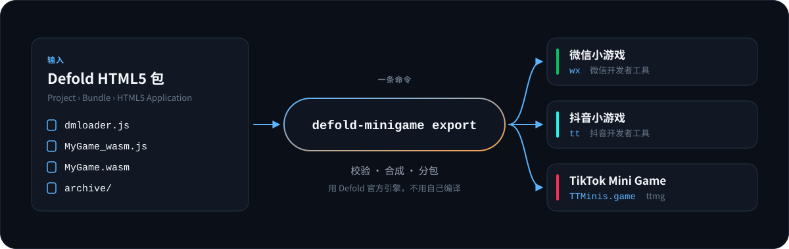
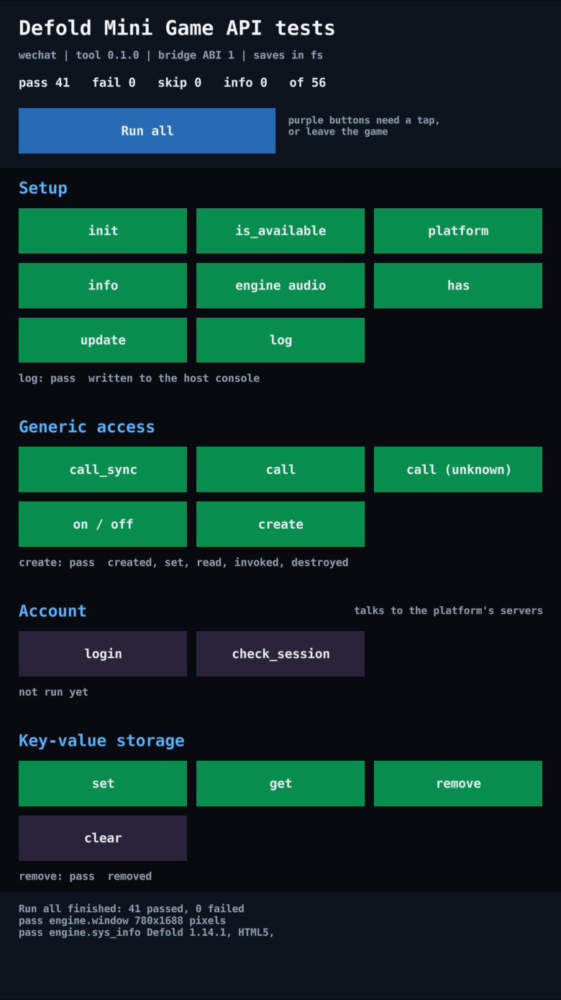
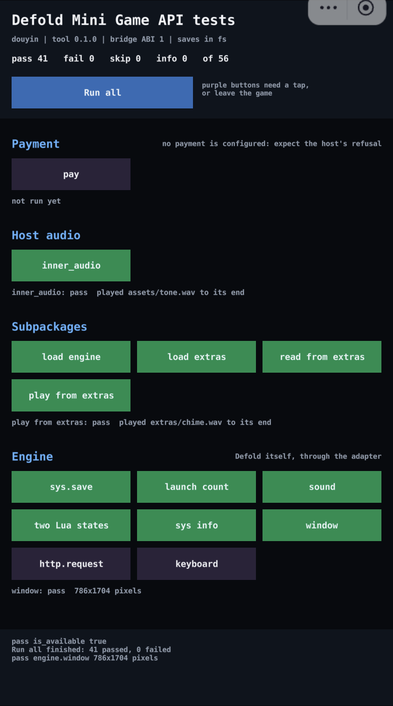
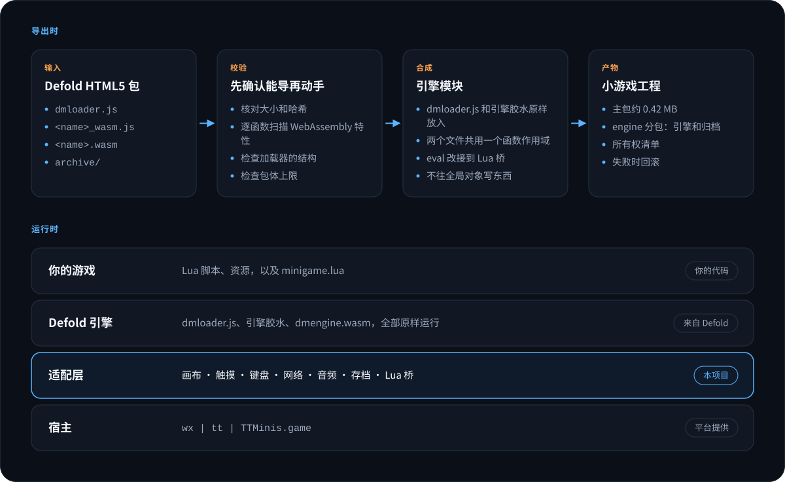
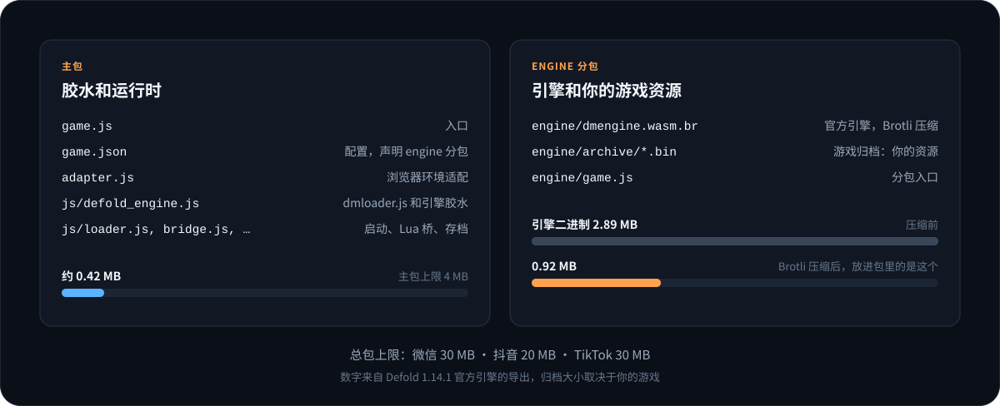

<h1 align="center">Defold Mini Game</h1>

<p align="center">
  <strong>把 Defold 打出的 HTML5 包，一条命令转成微信、抖音与 TikTok 小游戏工程。</strong>
</p>

<p align="center">
  <a href="docs/QUICK_START_zh.md">快速开始</a> ·
  <a href="docs/USAGE_zh.md">使用指南</a> ·
  <a href="docs/API_zh.md">Lua SDK</a> ·
  <a href="docs/ARCHITECTURE.md">架构</a> ·
  <a href="docs/RESEARCH_zh.md">调研与设计依据</a> ·
  <a href="https://anrans.github.io/defold_for_minigame/">官网</a> ·
  <a href="README.md">English</a>
</p>

<p align="center">
  
</p>

> [!WARNING]
> **当前是 v0.1.0 实验版。**
> 已经验证的是：200 多项自动化测试，对 Defold 1.14.0 和 1.14.1 官方引擎的静态核对，以及真实引擎在三个平台上的运行：微信、抖音开发者工具的模拟器，和微信、抖音、TikTok 的 iPhone、Android 真机。覆盖启动、渲染、触摸、存档、分包和 Lua SDK；声音在微信和抖音上验证过。
> 跑过的是仓库自带的测试应用。你自己的游戏上线前，仍然要在开发者工具和真机上测一遍。详见[验证状态](#验证状态)。

<p align="center">
  
  
</p>
<p align="center"><sub>真实截图：仓库自带的 API 功能测试列表，Defold 1.14.1。左边运行在微信开发者工具的模拟器里，右边运行在抖音开发者工具的模拟器里。绿色是通过，紫色的需要人点一下或会离开游戏。</sub></p>

<table>
  <tr>
    <td align="center" width="25%"><h3>不用自编引擎</h3><sub>直接用 Defold 官方 HTML5 引擎，不需要 Emscripten，也不需要定制引擎模板</sub></td>
    <td align="center" width="25%"><h3>3 个平台</h3><sub>微信、抖音、TikTok Native，同一个 HTML5 包导出</sub></td>
    <td align="center" width="25%"><h3>45 个 SDK 函数</h3><sub>Lua 模块 <code>minigame</code>，另可透传宿主的任意接口</sub></td>
    <td align="center" width="25%"><h3>0 个依赖</h3><sub>导出工具只需要 Node.js 20+，没有 npm 依赖</sub></td>
  </tr>
</table>

## 它做了什么

Defold 的 HTML5 包是给浏览器用的：`dmloader.js` 操作 DOM、用 XHR 下载资源，引擎胶水假设有 `window`、`document`、IndexedDB 和 `eval`。小游戏运行时这些都没有。Defold Mini Game 做三件事把它们接上：

- **导出**：读取 HTML5 包，校验引擎二进制用到的 WebAssembly 特性，把 `dmloader.js` 和引擎胶水原样放进一个作用域模块，生成 `game.js`、`game.json`、引擎分包和各平台的工程配置。
- **运行时适配**：在 `wx`、`tt` 或 `TTMinis.game` 之上提供引擎需要的画布、触摸、键盘、网络、音频和存档。
- **Lua SDK**：`minigame` 模块调用登录、存储、分享、广告、支付等平台能力，在编辑器和桌面端调用也不会报错。

<p align="center">
  
</p>

## 快速开始

需要 Node.js 20 或更高版本，以及一个 Defold HTML5 包。

1. **在 Defold 里打包**：`Project > Bundle > HTML5 Application`，架构只勾 `wasm-web`，Variant 选 Release。
2. **导出**：

   ```bash
   git clone --branch v0.1.0 --depth 1 https://github.com/AnranS/defold_for_minigame.git
   node defold_for_minigame/bin/defold-minigame.mjs export \
     --bundle  path/to/bundle/MyGame \
     --platform wechat \
     --appid   wx0123456789abcdef \
     --output  ../minigame-wechat
   ```

3. **运行**：用微信或抖音开发者工具打开输出目录。TikTok 在输出目录里执行 `ttmg init` 和 `ttmg dev`。

要调用平台能力，把本仓库加为 Defold 库依赖，再把 `/minigame/minigame.go` 放进启动 collection。库依赖的地址填在 `game.project` 的 Dependencies 里，和导出工具用同一个版本：

```text
https://github.com/AnranS/defold_for_minigame/archive/refs/tags/v0.1.0.zip
```

然后在脚本里：

```lua
local minigame = require "minigame.minigame"

minigame.login(function(code, err)
    if not err then print("login code", code) end
end)

minigame.storage_set("level", "5")
minigame.show_toast("Level " .. minigame.storage_get("level", "1"))
```

**[带说明的分步教程 →](docs/QUICK_START_zh.md)**

## 平台

| 平台 | 运行时 API | `game.json` 分包字段 | 总包上限 | 状态 |
|---|---|---|---|---|
| 微信小游戏 | `wx` | `subpackages` | 30 MB | 🧪 实验：真实引擎已在微信开发者工具和 iPhone、Android 真机上运行 |
| 抖音小游戏 | `tt` | `subPackages` | 20 MB | 🧪 实验：真实引擎已在抖音开发者工具和 iPhone、Android 真机上运行 |
| TikTok Mini Game Native | `TTMinis.game` | `subpackages` | 30 MB | 🧪 实验：真实引擎已通过 `ttmg dev` 在 iPhone 和 Android 手机上运行，需要 TikTok 43.4.0+ |

主包上限都是 4 MB。用 Defold 1.14.1 官方引擎导出的空项目，主包约 0.42 MB，引擎分包约 0.92 MB（引擎二进制从 2.89 MB 压到 0.92 MB），其余是你的游戏资源。

游戏自己的文件也可以做成分包：导出时加 `--subpackage levels=path/to/levels`，这个目录就成为名叫 `levels` 的分包，不占主包的 4 MB；游戏里调用 `minigame.load_subpackage("levels", ...)` 之后，文件就在 `levels/` 下可用。详见[使用指南](docs/USAGE_zh.md#12-包体与分包)。

<p align="center">
  
</p>

## 支持的 Defold 版本

| Defold | 引擎 SHA1 | 加载器 | 静态核对 | 开发者工具 | 真机 |
|---|---|---|---|---|---|
| **`1.14.1`**（最新） | `ee283d4dad9f` | 会话式 | ✅ | ✅ | ✅ |
| `1.14.0` | `d295ed4edff2` | 旧式 | ✅ | ⬜ | ⬜ |

开发者工具和真机两栏按平台记录：✅ 表示三个平台都跑过。Defold 在 1.14.1 重写了 HTML5 加载器的启动流程，所以运行时里有两条启动路径，测试对两条都覆盖。

1.14.2 的预发布版通过了同样的静态核对，defold.com 上用它构建的四个示例也在微信开发者工具里跑过。等 Defold 正式发布后再把它列进表里。

导出不绑定版本号：每次导出都会检查 `dmloader.js` 和引擎胶水的结构是否符合预期，不符合就停下并说明缺了什么。不在表里的版本可以导出，但会给出警告。[`support-matrix.json`](support-matrix.json) 是这些数值的唯一事实源。

## 验证状态

| 层级 | 内容 | 状态 |
|---|---|---|
| 单元测试 | wasm 特性扫描、包校验、引擎模块合成、导出事务、命令行 | ✅ 自动化 |
| 模拟宿主 | 真实的 Defold 1.14.0 和 1.14.1 `dmloader.js` 加引擎替身，在模拟的 `wx`、`tt`、`TTMinis.game` 里启动、触摸、键盘、存档、音频、网络 | ✅ 自动化 |
| Lua 联调 | LuaJIT 运行 `minigame.lua`，对接真实的 JS 桥 | ✅ 自动化 |
| 静态核对 | Defold 1.14.0 和 1.14.1 官方引擎胶水和二进制：结构、WebAssembly 特性、严格模式编译 | ✅ 已做 |
| 开发者工具 | 真实引擎和真实游戏包在微信开发者工具、抖音开发者工具和 `ttmg dev` 里运行 | ✅ 已做 |
| 真机 | 测试应用在微信、抖音、TikTok 的 iPhone 和 Android 手机上运行 | ✅ 已做 |

引擎替身是测试里代替 Emscripten 胶水的一段 JavaScript，它按真实胶水的约定工作，但不是真实引擎。所以模拟宿主测试能证明适配层自身的逻辑是自洽的，不能证明真实引擎能跑。真实引擎第一次运行就暴露了替身没有覆盖到的两件事：引擎通过 `style.setProperty()` 调整画布尺寸；微信开发者工具上报的是它所模拟机型的系统版本，引擎因此退回了 WebGL 1。两处都已修复，替身和测试现在也覆盖了它们。在抖音开发者工具里又发现两件：工具发出的点击，按下和抬起落在同一帧里，引擎看不到；工具打开工程时会重写 `project.config.json`，再次导出因此被拦下。这两处也已修复。

实际运行过的内容如下。开发者工具里的运行由 `scripts/devtools_probe.mjs` 采集证据（控制台日志、画布截图、回放的触摸）；手机上的运行是维护者手动做的，没有采集日志，机型、系统版本和客户端版本也没有记录：

- **微信开发者工具 36.6.0，Defold 1.14.1，仓库自带的 API 功能测试应用**，用 `bob.jar` 构建：41 项自动测试全部通过，包括加载游戏自己的分包、读取分包里的文件、播放分包里的声音。另外 15 项需要人点一下，或者会离开游戏。
- **抖音开发者工具 4.5.7，同一个应用**：同样 41 项全部通过；工具发出的点击和滑动能点到按钮；`sys.save()` 记的启动次数在重启后还在。
- **微信，iPhone 和 Android 手机，同一个应用**：自动测试全部通过。
- **抖音，iPhone 和 Android 手机，同一个应用**：自动测试全部通过。
- **TikTok，iPhone 和 Android 手机，通过 `ttmg dev`，同一个应用**：自动测试只有一项失败：`set_share_content`，因为 TikTok 没有设置分享菜单内容的接口（测试应用现在会在那里跳过这一项）。游戏自己的分包加载成功，`sys.save()` 写入键值存储后能读回。引擎声音在 TikTok 上默认关闭，不在这次运行里。
- **微信开发者工具 36.6.0，Defold 1.14.2（预发布版），defold.com 上的四个示例**：精灵和文字正常渲染；回放的触摸以预期的坐标到达游戏；`sys.save()` 保存的值落到了磁盘上，三次重启后都能读回；音乐示例的声音能听到。

每次运行都记录在 [`support-matrix.json`](support-matrix.json) 的 `hostRuns` 里。

## 已知限制

- **TikTok 默认没有引擎声音**：Defold 的混音器每个音频块新建一个 AudioBuffer 和 BufferSource，这种用法在 godot_for_minigame 的真机测试里让 TikTok 客户端崩溃过，所以默认关闭。请用 `minigame.inner_audio()` 播放，或自担风险用 `--engine-audio on` 打开。
- **资源只能放在包里**：游戏归档随引擎分包下发，不支持从 CDN 加载，受平台总包上限约束。`--subpackage` 的分包装的是游戏按路径读取的散文件（音频、图片、数据），Defold 归档里的内容不能拆进去。
- **TikTok 上不能预设分享菜单的内容**：TikTok 没有 `onShareAppMessage`，`minigame.set_share_content()` 在那里返回 `false` 和原因。用 `minigame.share()` 主动拉起分享。
- **`html5.run()` 不能执行 JavaScript**：小游戏禁用 `eval`，这个函数只用来和 `minigame` 模块通信。
- **老 iOS 需要 WebGL1 着色器**：引擎在 iOS 15.2 以下会自己退回 WebGL1；Defold 1.14.1 起默认不打包 WebGL1 着色器，需要在 `game.project` 里设置 `shader.exclude_gles_sm100 = 0`。
- **带 JS 库的原生扩展没有验证**：扩展的 JS 代码会和引擎胶水一起放进作用域模块，但没有测试过。
- **没有编辑器集成**：导出是命令行工具，Defold 编辑器里没有菜单项。
- **没有编辑器集成**：导出工具是命令行工具。
- **回调在轮询的那个脚本里执行**：结果由 `minigame.update()` 派发，自己调用它的脚本只收到自己的结果。回调里要用 `gui.*` 的 GUI 脚本，需要在自己的 `update()` 里调用它；`/minigame/minigame.go` 只照顾那些自己不轮询的脚本。
- **release 版里 `print()` 没有输出**：这是 Defold 的行为，不是宿主的问题。要写到宿主控制台，请用 `minigame.log()`。
- **重新导出后开发者工具可能还在用旧文件**：如果启动日志说某个归档文件的大小和导出时记录的不一致，重新编译一次，或者清掉开发者工具的编译缓存。

完整的兼容性说明见[使用指南](docs/USAGE_zh.md)。

## 文档导航

| 我想要…… | 文档 |
|---|---|
| 导出第一个游戏 | [快速开始](docs/QUICK_START_zh.md) |
| 了解每个选项和平台差异 | [使用指南](docs/USAGE_zh.md) |
| 查找 SDK 函数 | [Lua SDK 参考](docs/API_zh.md) |
| 理解导出和运行时的设计 | [架构](docs/ARCHITECTURE.md) |
| 了解为什么这样设计 | [调研与设计依据](docs/RESEARCH_zh.md) |
| 发布新版本、认证新的 Defold 版本 | [发布流程](docs/RELEASING.md) |

### API 功能测试应用

仓库根目录的 Defold 工程是一个测试应用：`minigame` 模块的每个函数都是一个按钮，“Run all” 会把不需要人点的那些全部跑一遍。用 Defold 的 `bob.jar` 可以一步完成构建和导出：

```bash
node bin/defold-minigame.mjs build --project . --bob path/to/bob.jar \
  --platform wechat --appid <你的 App ID> --assets example/assets \
  --subpackage extras=example/extras --output ../apitest-wechat
```

`--subpackage extras=example/extras` 把 `example/extras` 做成分包，“Subpackages” 一组的测试会加载它、读取并播放里面的文件；不带这个参数时这几项会跳过。

在开发者工具里打开输出目录，点按钮，结果显示在对应分组下面。每条结果也会以 `[apitest] <状态> <编号> <说明>` 的形式写进宿主的控制台。

`website/` 目录把这些文档生成为静态站点：`node website/build.mjs` 输出到 `website/dist`，`node website/serve.mjs` 在本机预览，并打印访问地址（从 4780 端口开始，被别的程序占用时自动换下一个）。它同样没有任何依赖。仓库开启 GitHub Pages 之后，`deploy-pages` 工作流会从 `main` 分支自动发布。

## 参与贡献

提交前运行 `./scripts/test.sh`（需要 Node.js 20+；装了 LuaJIT 会多跑 Lua 联调测试）。它会跑测试、检查 API 参考和 `docs/images/` 里的图是否与来源一致，并构建和检查官网。图由 `scripts/generate_diagrams.mjs` 生成，要改图请改这个脚本，不要直接改 SVG。平台差异应当留在 `PlatformRuntime` 和 Lua 桥之后，不要在业务代码里直接判断 `wx` 或 `tt`。

## 许可证

[MIT](LICENSE)。导出产物里的 Defold 引擎文件保留 Defold License，见 [`THIRD_PARTY_NOTICES.md`](THIRD_PARTY_NOTICES.md)。运行时的平台检测和导出事务设计改编自 [godot_for_minigame](https://github.com/AnranS/godot_for_minigame)。
