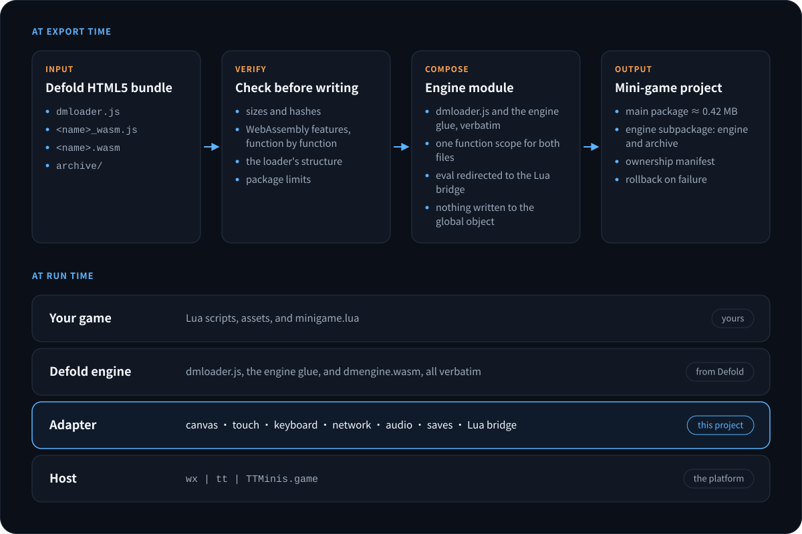
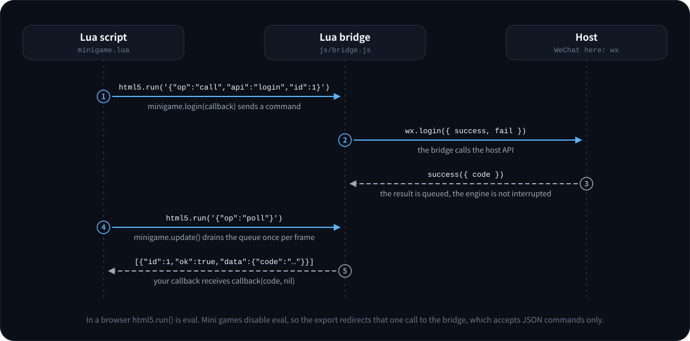

# Architecture / 架构

Defold Mini Game has two halves: an **exporter** that runs on the developer's
machine, and a **runtime** that ships inside every exported package. This
document describes the contracts between them, Defold, and the mini-game hosts.

Defold Mini Game 分两部分：在开发者机器上运行的**导出器**，和随每个导出包下发的
**运行时**。本文说明它们与 Defold、小游戏宿主之间的契约。

## Components / 组件



```text
Defold HTML5 bundle                      exported mini-game project
┌──────────────────────┐                ┌──────────────────────────────────┐
│ dmloader.js          │                │ game.js            entry         │
│ <exe>_wasm.js  glue  │   exporter     │ adapter.js         DOM / input   │
│ <exe>.wasm           │ ─────────────▶ │ js/loader.js       boot          │
│ archive/*            │                │ js/idb_store.js    saves         │
└──────────────────────┘                │ js/bridge.js       Lua ⇄ host    │
                                        │ js/defold_engine.js  dmloader +  │
  bundle.mjs         read and verify    │                      glue        │
  wasm_features.mjs  scan the binary    │ engine/dmengine.wasm.br          │
  engine_module.mjs  compose            │ engine/archive/*.bin             │
  output_guard.mjs   publish            └──────────────────────────────────┘
```

- `src/exporter.mjs` owns one export: options, bundle, scan, composition,
  package limits, publish.
- `src/engine_module.mjs` turns `dmloader.js` and the glue into one module.
- `src/output_guard.mjs` owns the destination folder.
- `runtime/common/js/platform_runtime.js` selects exactly one provider: `wx`,
  `tt`, or `TTMinis.game`. Every other runtime module asks it, none probes a
  host global on its own.
- `runtime/common/adapter.js` builds the browser objects the engine expects.
- `runtime/common/js/loader.js` boots the engine.
- `runtime/common/js/bridge.js` and `minigame/minigame.lua` are the two ends of
  the Lua bridge.

## The engine module / 引擎模块

In a browser `dmloader.js` and the Emscripten glue are two `<script>` tags that
share the page's global scope: the loader reads the glue's `FS`, `IDBFS`,
`DMSYS`, and `dmRenderer`; the glue reads the loader's `Module`. Mini-game
modules have no shared global scope, no `document`, and — on TikTok — a
`GameGlobal` that is not the global object.

The exporter writes both files, in order, into one function:

```js
function bootDefoldEngine(host) {
  var window = host.window, document = host.document, /* … 38 bindings … */;
  var i, total, downloaded;         // dmloader's implicit globals

  /* dmloader.js, verbatim */

  host.configure({ CUSTOM_PARAMETERS, EngineLoader, Module, GameStartup, … });

  /* engine glue, verbatim */

  host.onGlueLoaded({ Module });
}
```

Because both sources live in the same function scope, their top-level `var`s
see each other exactly as they do in a browser, and nothing has to be renamed.
The browser globals the engine reads become local variables bound to the
adapter, so the host's own `window` or `WebAssembly` is never touched.

浏览器里 `dmloader.js` 和引擎胶水共享页面的全局作用域。导出器把两个文件按顺序
原样放进同一个函数，顶层 `var` 互相可见，不需要改名；引擎读取的浏览器全局量变成
绑定到适配层的局部变量，宿主自己的 `window`、`WebAssembly` 不会被改动。

Only two mechanical rewrites are applied, and both are counted in the export
report:

| Rewrite | Why |
|---|---|
| the engine's `eval(` call → `__defoldMiniGameEval(` | hosts disable `eval`; this is how `html5.run()` reaches the Lua bridge |
| `function(_, _)` → `function(_, _unused)` in dmloader.js | duplicate parameter names are a syntax error in strict mode, which host toolchains may impose |

The composed module is compiled, never executed, in sloppy and in strict mode
before it is written. A syntax error stops the export.

## Loader generations / 两代加载器

Defold has shipped two start-up designs. The exporter detects which one a
bundle uses and records it; the runtime boots each one differently.

| | `legacy` (≤ 1.14.0) | `session` (≥ 1.14.1) |
|---|---|---|
| Who orders start-up | every callback calls `Module._preloadAndCallMain()` | `GameStartup` awaits signals |
| Marker | `_preloadAndCallMain` | `var GameStartup` |
| How the runtime boots it | registers the archive through `Module.onArchiveFileLoaded` / `onArchiveLoaded`; dmloader calls main | begins a session, feeds the archive, awaits the session's `runtime` and `storage` signals, then calls `preloadAll()` and `_callMain()` itself |

In both cases the runtime replaces exactly three things a web page would have
done: downloading the archive, downloading and instantiating the WebAssembly
binary (`Module.instantiateWasm`), and the DOM progress bar (`ProgressView`).
Everything else — mounting the persistent file system, the initial sync,
`runApp`, calling main — is dmloader's own code.

A start is reported only after `main()` returns without throwing; the 1.14.1
loader additionally fails the start when main returns a non-zero exit code.

Defold 有两种启动设计，导出器识别并记录，运行时各走一条路径。两种情况下运行时都
只替换网页原本做的三件事：下载归档、下载并实例化 WebAssembly、DOM 进度条。挂载
持久文件系统、初始同步、`runApp`、调用 main 仍然是 dmloader 自己的代码。

## WebAssembly policy / WebAssembly 策略

`src/wasm_features.mjs` decodes every function body of the engine binary,
including immediates, and classifies the proposals it uses. Release engines
strip the `target_features` section, so the instruction stream is the only
reliable evidence.

| Blocking | Reported only |
|---|---|
| SIMD, threads / shared memory, exception handling, 64-bit memory, tail calls, GC, multiple memories | bulk memory, sign extension, non-trapping conversions, reference types, multi-value, mutable globals, i64 on the JS boundary |

A body that cannot be decoded makes the scan incomplete, and an incomplete
scan fails the export rather than passing by default.

## Persistence / 存档

dmloader mounts Defold's persistent root as Emscripten IDBFS, which mirrors a
MEMFS directory into IndexedDB. `js/idb_store.js` implements the subset of
IndexedDB that IDBFS uses — one object store with out-of-line keys, a
`timestamp` index walked with a key cursor, `get` / `put` / `delete`, and
transactions that complete after their last request — over a pluggable
backend:

| Backend | Used on | Layout |
|---|---|---|
| `fs` | WeChat, Douyin | `USER_DATA_PATH/defold-minigame/idb/<db>/index.json` plus one `b<N>.bin` per file |
| `storage` | TikTok | key-value storage, base64 payloads |
| `memory` | no durable storage, or `--persistence off` | volatile |

New contents are written under a new id first, then the index is replaced
(temp file plus rename on `fs`), then replaced contents are removed. A crash
between the steps leaves the previous index readable.

The game archive is never part of this: it is read from the package into
memory on every launch.

## The Lua bridge / Lua 桥



```text
minigame.lua ── html5.run(json) ──▶ bridge.run ──▶ PlatformRuntime.api
     ▲                                  │
     └──── poll once per frame ◀── event queue ◀── success / fail / host events
```

- The handshake is one fixed expression. In a browser it evaluates to an empty
  string; in a mini game the bridge recognises it without evaluating anything.
- After the handshake Lua sends JSON commands only: `call`, `sync`, `on`,
  `off`, `new`, `invoke`, `listen`, `get`, `set`, `release`, `share`, `has`,
  `poll`, `log`. Any other string raises a Lua error that says why.
- Asynchronous results are queued and drained by `minigame.update()`.
- Results find their owner twice over. The bridge names every Lua state that
  performs the handshake (`c1`, `c2`, …); ids and object handles carry that
  name, and a poll returns only that client's events. That covers projects
  whose game object scripts and GUI scripts run in separate Lua states. Inside
  one Lua state, which is what Defold 1.14.1 gives a project by default, the
  module records the script that registered each callback (`msg.url()`), and
  `update()` delivers a result only while its own script is the one polling.
  A script that never polls is served by one that does. Without this a GUI
  callback delivered by a game object script fails with "Node used in the
  wrong scene"; the first run in WeChat DevTools found exactly that.
- `log` writes to the host's console. A release build of the engine drops
  `print()`, so `minigame.log()` and the module's own warnings go through it.
- The bridge ABI is versioned (`bridgeAbi` in `support-matrix.json`). The Lua
  module refuses to talk to a runtime with a different ABI.
- A per-platform block list keeps Lua away from host calls that can terminate
  the client (TikTok: storage enumeration, battery, file system).

## Export transaction / 导出事务

Nothing is written into the destination directly.

1. Validate options, read and verify the bundle, scan the binary, compose the
   engine module, check package limits. Any failure stops here.
2. Write every file into a sibling staging directory and describe it in a
   manifest (path, size, SHA-256).
3. Verify the staged tree against its manifest.
4. Take a sibling lock, re-check the destination, move exporter-owned
   top-level paths to a sibling backup, move the staged paths in.
5. On failure, restore the backup. On success, remove it.

The exporter owns `game.js`, `game.json`, `project.config.json`,
`project.private.config.json`, `adapter.js`, `js/`, `engine/`, `assets/`, and
the manifest. Other top-level names are sidecars and are preserved. Before
anything moves, every owned file is checked against the previous manifest:
an edited file or an unknown file inside an owned directory stops the export
unless `--force` is given.

The swap and its in-process rollback are transactional; they are not a
crash-atomic primitive. A killed process can leave a `.lock`, `.staging-*`, or
`.backup-*` beside the output, and the next export stops and reports it.

导出不直接写目标目录：先在同级暂存目录生成并校验，再在锁内替换自己拥有的顶层路径，
失败则回滚。其它顶层名称属于旁路文件，原样保留。这是事务语义，不是跨崩溃的原子
操作；进程被杀后留下的 lock、staging、backup 会被下一次导出报告出来。

## Version axes / 版本轴

| Axis | Changes when | Rule |
|---|---|---|
| Tool SemVer (`toolVersion`) | exporter or runtime behaviour changes | pre-1.0: breaking changes bump the minor |
| Bridge ABI (`bridgeAbi`) | the Lua ⇄ JS protocol changes | must match exactly; the Lua module disables itself otherwise |
| Runtime schema (`runtimeSchema`) | `js/boot_config.js` changes meaning | the loader and the exporter ship together |
| Output manifest schema | ownership metadata changes | only a recognised manifest owns a folder |

Defold compatibility is data in `support-matrix.json`, with validation levels
per engine version: `staticContract`, `wasmFeatureScan`, and, kept per
platform, `devtool` and `realDevice`. A level is `verified` only when that
check was actually run on that version, and every `verified` developer-tool
level has a record under `hostRuns` that says what ran, where, and with what
result. An automated simulated-host pass is never presented as developer-tool
or device certification.

## What the simulated hosts do and do not prove / 模拟宿主能证明什么

`test/sim/host.mjs` builds an isolated realm per provider and runs an exported
package in it, entry file first. Its TikTok flavour keeps `GameGlobal` apart
from the global object, exposes `wx` and `tt` aliases, and "crashes" on
file-system writes and storage enumeration, as the real client was observed to.

The engine in those tests is a stand-in (`test/fixtures/fake_engine_glue.js`):
plain JavaScript that follows the glue's contract — the Emscripten run
sequence, `FS` / `IDBFS` with Emscripten's reconcile algorithm, the listener
layout and coordinate conversion of Defold's web platform layer, the single
`eval` call. `dmloader.js` in those tests is the real one from Defold.

That proves the exporter, the adapter, the loader, the persistence store, and
the bridge are consistent with the real loader and with the documented host
contracts. It does not prove that the real engine renders, sounds, or performs
in a real host.

模拟宿主里的引擎是替身，`dmloader.js` 是 Defold 的真实文件。这些测试能证明导出器、
适配层、加载器、存档和桥与真实加载器及宿主文档的约定一致，不能证明真实引擎在真实
宿主里能渲染、出声或达到性能要求。

## Runs in a developer tool / 开发者工具里的运行

The stand-in has to be told what the real engine does, and the first run of a
real engine told it two things it did not know:

- The engine sizes its canvas on its first buffer swap, through Emscripten's
  `Browser.updateCanvasDimensions()`, which calls `canvas.style.setProperty()`
  and `removeProperty()`. The adapter's style objects had neither.
- WeChat DevTools reports the system of the device it simulates ("iOS 10.0.1"
  for an iPhone 12) while the game runs in the tool's own Chromium. Turned
  into a user agent, that sent the engine to WebGL 1, for which a Defold
  1.14.1+ bundle has no shaders. A host that reports `platform: "devtools"`
  now gets a user agent without a system version.

Both are fixed, the stand-in now runs Emscripten's canvas-sizing code
statement for statement, and tests reproduce both failures.

A mini game's console cannot be read from outside the developer tool, so
`scripts/devtools_probe.mjs` injects a test-only module into an exported
project. It mirrors the console to a file in the game's user data folder,
which the simulator keeps on disk; copies the frame buffer after chosen
frames; replays touches through the handlers the adapter registered; and
counts the audio blocks the engine hands to the host. A probed run is silent
unless asked otherwise.

真实引擎第一次运行暴露了替身不知道的两件事：引擎在第一次交换缓冲时通过
`canvas.style.setProperty()` 调整画布尺寸；微信开发者工具上报的是它所模拟机型的
系统版本，引擎因此退回 WebGL 1。两处都已修复，替身现在逐句执行 Emscripten 调整
画布的代码，测试能复现这两个失败。小游戏的控制台无法从开发者工具外部读取，所以
`scripts/devtools_probe.mjs` 往导出工程里注入一个仅供测试的模块：把控制台镜像到
用户数据目录、在指定帧之后复制帧缓冲、回放触摸、统计引擎提交的音频块，默认静音。
