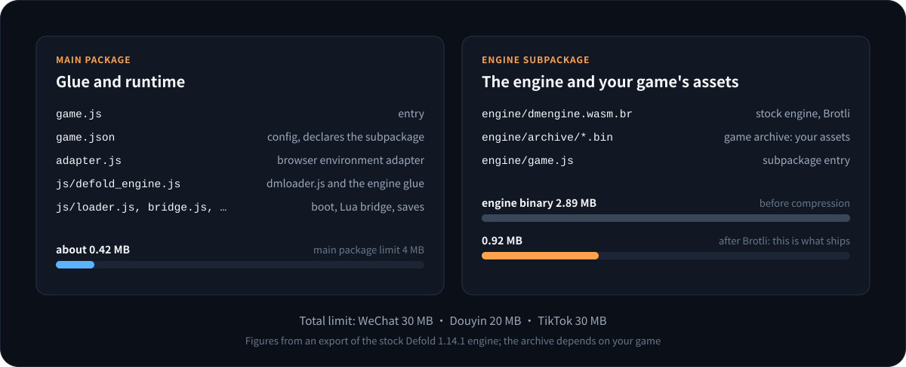
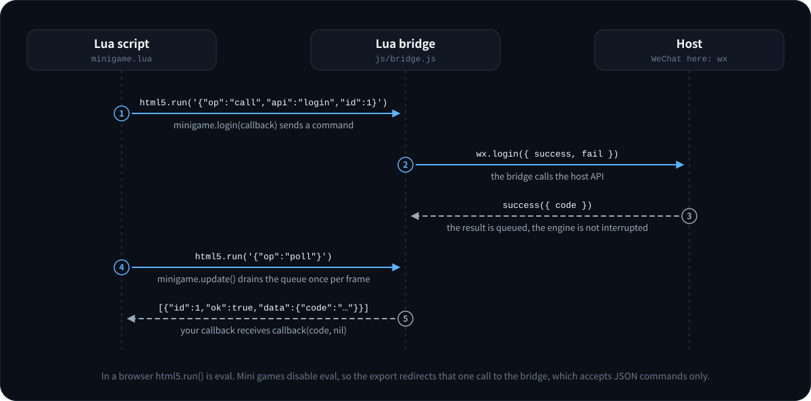

# Defold Mini Game usage guide

This guide covers every exporter option, the differences between the three platforms, and the runtime behaviour of saves, audio, input, display, network, and package size. If this is your first export, start with the [quick start](QUICK_START.md).

> [!WARNING]
> v0.1.0 is experimental. Start-up, rendering, touch, saves, subpackages, and the Lua SDK have run with the real engine on all three platforms: in the WeChat DevTools and Douyin DevTools simulators, and on an iPhone and an Android phone in WeChat, Douyin, and TikTok. Sound has run on WeChat and Douyin. What ran is the test app in this repository; everything else described here comes from the code and from simulated-host tests. Test the entries marked "untested" yourself in particular.

## 1. Requirements

- **Node.js 20 or later.** The exporter has no npm dependencies.
- **Defold.** Checked versions are 1.14.0 and 1.14.1; see [Supported Defold versions](#15-supported-defold-versions) for others.
- **A platform developer tool**: WeChat DevTools, Douyin DevTools, or TikTok's `ttmg` (which needs TikTok client 43.4.0 or later).
- **LuaJIT** (optional). Only for this repository's Lua integration tests.

## 2. Building the HTML5 bundle

The exporter's input is the HTML5 bundle Defold writes. It does not build the project itself.

**In the editor**: `Project > Bundle > HTML5 Application`, keep the `wasm-web` architecture, variant Release.

**On the command line** (needs bob.jar and the JDK the Defold manual asks for, OpenJDK 25 for 1.14):

```bash
java -jar bob.jar --root . --archive --platform wasm-web --architectures wasm-web \
  --variant release --bundle-output ./bundle resolve build bundle
```

The exporter's `build` command runs that for you; see the next section.

What the project needs:

| Setting | Requirement | Why |
|---|---|---|
| Architectures | include `wasm-web` | Mini games have no WebAssembly threads; a threaded engine is ignored |
| `shader.exclude_gles_sm100` | `0` if you support iOS below 15.2 | The engine falls back to WebGL 1 there and needs WebGL 1 shaders, which Defold 1.14.1+ leaves out by default |
| `html5.heap_size` | sized for the game | The default is 256 MB, which is a lot for low-end phones; `--heap-size` overrides it at export |
| `display.high_dpi` | as needed | Decides whether the canvas uses the device pixel ratio; see [Display](#10-display) |

## 3. Commands

```bash
node bin/defold-minigame.mjs export  --bundle <dir> --platform <name> --appid <id> --output <dir> [options]
node bin/defold-minigame.mjs build   --project <dir> --bob <bob.jar> --platform <name> --appid <id> --output <dir> [options]
node bin/defold-minigame.mjs inspect --bundle <dir>
```

- `export` converts an existing HTML5 bundle.
- `build` runs bob.jar on a project first, then exports the bundle. It needs `--project` and `--bob`; `--java` selects the java executable and `--variant` is `release` or `debug`.
- `inspect` reports a bundle's engine version, sizes, WebAssembly features, and whether it can be exported. It writes nothing.

Exit codes: `0` success, `1` the export was refused (the reason and a hint are printed), `2` a usage error.

### Required

| Option | Meaning |
|---|---|
| `--platform` | `wechat`, `douyin`, or `tiktok`. One export targets one platform |
| `--appid` | The App ID from the platform console; the Client Key for TikTok |
| `--output` | The destination. Empty, or a folder this tool exported into before; it and the bundle must not contain one another |

### Optional

| Option | Default | Meaning |
|---|---|---|
| `--name` | the bundle's executable name | Project name shown in the developer tool |
| `--orientation` | `auto` | `portrait`, `landscape`, or `auto`, which compares `display.width` and `display.height` |
| `--heap-size <MB>` | the project's `html5.heap_size` | Initial WebAssembly heap, 32 to 2048 |
| `--pixel-ratio <auto\|n>` | `auto` | Canvas pixel ratio. `auto` uses the device ratio when `display.high_dpi` is set, otherwise 1 |
| `--max-pixel-ratio <n>` | the project's `html5.max_pixel_ratio`, or `2` when it has none | Upper bound of the automatic ratio |
| `--engine-audio <auto\|on\|off>` | `auto` | Whether the engine mixer gets an audio context. `auto` keeps it off on TikTok |
| `--persistence <auto\|fs\|storage\|off>` | `auto` | Where saves go. `auto` uses key-value storage on TikTok and files elsewhere |
| `--assets <dir>` | none | Copy a folder of loose files into the package as `assets/`, inside the main package |
| `--subpackage <name>=<dir>` | none | Ship a folder as a subpackage the game loads with `minigame.load_subpackage("<name>")`; repeatable. See [Package size and subpackages](#12-package-size-and-subpackages) |
| `--loading-text <text>` | per platform | Text of the host loading indicator; an empty string disables it |
| `--engine-arg <arg>` | none | Extra engine argument; repeatable |
| `--total-limit-mb <MB>` | the platform limit | Override the total package limit, for example 30 for Douyin with virtual payment enabled |
| `--no-brotli` | off | Ship the engine binary uncompressed |
| `--allow-wasm-feature <name>` | none | Export although the engine uses a blocked WebAssembly feature; repeatable |
| `--allow-missing-bridge` | off | Export although the engine glue has no `eval` call; the Lua SDK is then unavailable |
| `--force` | off | Replace exporter-owned files that were edited by hand, and put the project files back to the export's own version |
| `--json` | off | Print the result as JSON |

## 4. What an export contains



```text
<output>/
├── .defold-mini-game-export.json   ownership manifest: size and SHA-256 of every file
├── game.js                         platform entry point
├── game.json                       platform configuration: orientation, subpackages
├── project.config.json             developer-tool project file
├── project.private.config.json     WeChat only
├── adapter.js                      DOM, input, audio, and network adapter
├── js/
│   ├── boot_config.js              the parameters of this export
│   ├── platform_runtime.js         selects wx / tt / TTMinis.game and detects capabilities
│   ├── loader.js                   loads the subpackage, reads the archive, boots the engine
│   ├── idb_store.js                IndexedDB implementation for saves
│   ├── bridge.js                   the bridge between Lua and the host
│   └── defold_engine.js            your dmloader.js and engine glue in one scoped module
├── engine/                         subpackage "engine"
│   ├── game.js                     placeholder
│   ├── dmengine.wasm.br            engine binary, Brotli-compressed
│   └── archive/*.bin               game archive
├── assets/                         only with --assets
└── <name>/                         one per --subpackage: your files and a placeholder game.js
```

The main package is everything outside `engine/` and your own subpackages: about 0.42 MB with the stock Defold 1.14.1 engine.

The extra `.bin` on the archive files is deliberate. WeChat only uploads files with whitelisted extensions, and `.arcd`, `.arci`, `.dmanifest`, `.projectc`, and `.der` are not on the list.

## 5. The three platforms

| | WeChat | Douyin | TikTok Native |
|---|---|---|---|
| Runtime API | `wx` | `tt` | `TTMinis.game` |
| WebAssembly API | `WXWebAssembly` | `TTWebAssembly` | `TTWebAssembly` |
| `game.json` subpackage field | `subpackages` | `subPackages` | `subpackages` |
| Main package limit | 4 MB | 4 MB | 4 MB |
| Total limit | 30 MB | 20 MB (30 MB with virtual payment) | 30 MB |
| Save backend | files | files | key-value storage |
| Engine sound | on | on | off by default |
| Loading text | 加载中 | 加载中 | Loading |
| Developer tool | WeChat DevTools | Douyin DevTools | `ttmg` |

TikTok is not an alias for Douyin. Entry point, configuration, and runtime namespace all differ, and the TikTok host also exposes `wx` and `tt` compatibility aliases; whenever the runtime sees `TTMinis.game` it treats the host as TikTok.

Two things are different on TikTok, both learned from device tests in [godot_for_minigame](https://github.com/AnranS/godot_for_minigame):

- Writing to the file system and calling `getStorageInfoSync` can make the client exit, so saves go to key-value storage and the Lua bridge blocks those calls.
- The way the engine mixer plays audio crashed the client, so the engine gets no AudioContext by default.

A third comes from this project's own run on an iPhone and an Android phone: TikTok has no `onShareAppMessage`, so the content of the share menu cannot be set ahead of time. `minigame.set_share_content()` returns `false` and the reason there; call `minigame.share()` to share.

## 6. Lua SDK



### Setup

1. Add this repository as a library dependency and run **Project > Fetch Libraries**. Dependencies in `game.project` takes the address of a released version, the same version as the exporter:

   ```text
   https://github.com/AnranS/defold_for_minigame/archive/refs/tags/v0.1.0.zip
   ```

2. Put `/minigame/minigame.go` into the bootstrap collection. It finds the bridge in `init` and delivers asynchronous results in `update`. If you would rather not add it, call `minigame.update()` once per frame from one of your scripts. A GUI script that uses `gui.*` in its callbacks calls `minigame.update()` in its own `update()` as well; the next section says why.
3. `local minigame = require "minigame.minigame"`.

### Callbacks

The first argument is the result, `nil` on failure; the last one is an error string, `nil` on success.

A callback runs in the script that calls `minigame.update()`. That matters because `gui.*`, `go.*` with a relative address, and `msg.post(".")` act on the script that is running:

- A script that calls `minigame.update()` gets the results of its own calls, and no other script's.
- A script that never calls it is served by a script that does, usually `/minigame/minigame.go`.

So a GUI script whose callbacks touch its nodes calls `minigame.update()` in its own `update()`; without that, the callback fails with "Node used in the wrong scene". A game object script whose callbacks only set values or post messages to absolute addresses needs nothing beyond `minigame.go`.

### Logging

A release build of the engine drops `print()`. `minigame.log(message, level)` writes to the host's console in every build; `level` is `"info"`, `"warn"`, or `"error"`. The module's own warnings, such as a callback that raised an error, go there too.

### Common features

```lua
-- Login: send the code to your own server
minigame.login(function(code, err) ... end)

-- Key-value storage for small strings
minigame.storage_set("level", "5")
local level = minigame.storage_get("level", "1")

-- Native UI
minigame.show_toast("Saved", { icon = "success" })
minigame.show_modal({ title = "Quit", content = "Really quit?" }, function(confirmed) ... end)

-- Sharing: set what the host menu shares ahead of time (TikTok has no such hook; use minigame.share() there)
minigame.set_share_content({ title = "Play with me", query = "from=share" })

-- Lifecycle
minigame.on_hide(function() sys.save(save_file, state) end)

-- Safe area and the host's menu capsule
local safe = minigame.get_safe_area()
local capsule = minigame.get_menu_button_rect()
```

### Rewarded video

```lua
local ad = minigame.create_rewarded_video_ad("adunit-xxxxxxxx")
ad:show(function(ended, err)
    if ended then
        give_reward()
    end
end)
```

### Payment

```lua
minigame.request_payment(options, function(paid, err) ... end)
```

`options` is passed to the host unchanged. The three platforms take entirely different fields; follow each platform's payment documentation.

| Platform | Host call |
|---|---|
| WeChat | `wx.requestMidasPayment` |
| Douyin | `tt.requestGamePayment` |
| TikTok | `TTMinis.game.pay` |

### APIs without a wrapper

Any host API can be called directly:

```lua
-- Asynchronous APIs: success / fail become one callback
minigame.call("getSetting", {}, function(result, err) ... end)

-- Synchronous APIs: positional arguments
local info = minigame.call_sync("getAccountInfoSync")

-- Events
local id = minigame.on("onMemoryWarning", function(event) ... end)
minigame.off(id)

-- APIs that return an object
local banner = minigame.create("createBannerAd", { adUnitId = "...", style = { left = 0, top = 0, width = 300 } })
banner:invoke("show")
banner:destroy()
```

`minigame.has("apiName")` tells you whether the host has an API before you call it.

### Outside a mini game

In the editor, on desktop, and in a plain HTML5 bundle, `minigame.is_available()` returns `false`, getters return defaults, and callbacks receive `"not running in a mini game"` immediately. SDK calls do not need a platform check around them.

### `html5.run()`

Mini games disable `eval`, so `html5.run()` cannot execute JavaScript. At export, the engine's one `eval` call is redirected to the Lua bridge, which only accepts the commands of the `minigame` module; any other string raises a Lua error that explains why.

The full list is in the [Lua SDK reference](API.md).

## 7. Saves

`sys.save()`, `sys.load()`, and `io.*` write to Defold's persistent directory, as on every other platform. No code changes are needed.

Underneath, the engine mounts that directory as Emscripten IDBFS, which mirrors it into IndexedDB. Mini games have no IndexedDB, so the runtime provides the small part of it that IDBFS uses and puts the data into host storage:

| Backend | Used on | Where | Note |
|---|---|---|---|
| `fs` | WeChat, Douyin | one `.bin` per file and an `index.json` under `USER_DATA_PATH/defold-minigame/idb/` | bounded by the host's user-data quota |
| `storage` | TikTok | key-value storage, base64-encoded | hosts limit the size of one key; keep saves small |
| `memory` | `--persistence off`, or a host with neither | memory only | lost on restart; a warning is printed at start-up |

Saves are restored before the engine calls `main`, so `sys.load()` returns the previous data on the first frame.

The game archive never goes into the persistent directory. It is read from the package into memory on every launch, so an updated game never reads stale assets.

## 8. Audio

Defold mixes audio in WebAssembly and plays each mixed block through Web Audio.

| Platform | Engine mixer | Host API |
|---|---|---|
| WeChat | on | `wx.createWebAudioContext()` |
| Douyin | on | `tt.getAudioContext()` |
| TikTok | off by default | none |

The mixer's audio context is suspended when the game goes to the background and resumed when it returns.

**TikTok.** An engine that finds no AudioContext runs silently: `sound.play()` does not fail, and makes no sound. Check `minigame.has_engine_audio()` and use the host's player instead:

```lua
if not minigame.has_engine_audio() then
    local bgm = minigame.inner_audio("assets/audio/bgm.mp3", { loop = true })
    bgm:play()
end
```

The audio files have to be loose files in the package; ship them with `--assets`:

```bash
node bin/defold-minigame.mjs export ... --assets ./minigame_assets
# ./minigame_assets/audio/bgm.mp3 → assets/audio/bgm.mp3 in the package
```

Files from `--assets` count towards the 4 MB of the main package. Put a lot of audio into [a subpackage of your own](#your-own-subpackages) instead.

`--engine-audio on` forces the engine mixer on for TikTok. That combination is untested, and the same playback pattern crashed the client in godot_for_minigame's device tests.

## 9. Input

**Touch.** Host touch events are passed to the engine as they are; multi-touch works. The engine itself treats the first touch as the left mouse button, so actions bound to `MOUSE_BUTTON_LEFT` keep working.

**Text input.** `gui.show_keyboard()` opens the host keyboard. The host reports the whole text of its input field each time; the runtime turns the difference from the previous text back into keys: added characters become character input, removed characters become backspaces, and confirm becomes Enter. The game receives `action.text` in `on_input` as usual. This is a basic implementation without cursor movement inside the text.

**Physical keyboards and gamepads** do not exist in mini games.

## 10. Display

- **Pixel ratio.** Without `display.high_dpi` the canvas is created at 1× logical pixels and looks soft on high-density screens. With it, the canvas uses the device pixel ratio, within the project's `html5.min_pixel_ratio` and `html5.max_pixel_ratio`, and capped at 2 when the project sets no maximum. `--pixel-ratio` pins a value and `--max-pixel-ratio` changes the cap. A higher ratio is sharper and costs fill rate. `window.get_display_scale()` returns this value.
- **Orientation** is written into `game.json` and cannot change at run time.
- **Window changes.** When the host reports a new window size the canvas follows, and the engine picks it up on its next frame.
- **Safe area.** Use `minigame.get_safe_area()` and `minigame.get_menu_button_rect()` to stay clear of notches and the menu capsule.
- **WebGL version.** The engine asks for WebGL 2 and falls back to WebGL 1. Below iOS 15.2 it uses WebGL 1 directly. WeChat's documentation advises against WebGL 2 below iOS 15.5.

## 11. Network

`http.request()` goes through the host's `request` API. Before release, add your domains to each platform's list of allowed request domains; in a developer tool you can switch the domain check off first.

WebSocket goes through the host's `connectSocket`. It exists for native extensions that use WebSocket, and that path is untested.

## 12. Package size and subpackages

The export checks the main package and the total against the platform limits and refuses with the amount it is over.

| Part | Where | Size (stock Defold 1.14.1 engine) |
|---|---|---|
| Engine glue, loader, adapter | main package | about 0.42 MB |
| Engine binary | `engine` subpackage | 2.89 MB, 0.92 MB after Brotli |
| Game archive | `engine` subpackage | depends on the game |

| Files from `--assets` | main package | depends on the game |
| Files from `--subpackage` | a subpackage each | depends on the game |

The archive can only ship in the package; it cannot be loaded from a CDN. Over the total limit, the only option is a smaller archive: compress textures, drop unused assets, or split content out with Defold's Live Update (untested in mini games).

### Your own subpackages

Loose files the game reaches by path (audio, images, data) can ship as a subpackage. A subpackage is outside the 4 MB of the main package and is not downloaded at start-up; the game loads it when it needs it.

```bash
node bin/defold-minigame.mjs export ... \
  --subpackage levels=./minigame_levels \
  --subpackage voices=./minigame_voices
# ./minigame_levels/boss.mp3 → levels/boss.mp3 in the package, part of the subpackage "levels"
```

The export copies each folder into a folder of the subpackage's name and declares it in `game.json` under the platform's field (`subpackages` or `subPackages`). A host loads a subpackage by running the `game.js` at its root; the export adds an empty one unless the folder brings its own.

In the game:

```lua
minigame.load_subpackage("levels", function(loaded, err)
    if not loaded then
        print("levels did not load:", err)
        return
    end
    local bgm = minigame.inner_audio("levels/boss.mp3", { loop = true })
    bgm:play()
end, function(percent)
    print("levels", percent, "%")
end)
```

- Until it is loaded, the files of a subpackage do not exist; afterwards their path is `name/file`. Loading a subpackage that is already loaded succeeds at once.
- `minigame.info().subpackages` lists the names this export declared. The host refuses a name that was not declared, and the callback gets its message.
- A name starts with a letter and uses letters, digits, `-`, and `_`, 32 characters at most. It cannot be a name the export uses itself (`engine`, `js`, `assets`).
- Subpackages count towards the total limit, not the main package. WeChat does not limit the size of one regular subpackage; on Douyin one subpackage cannot be larger than the total limit.
- Hidden files (names that start with `.`) are not copied. Files whose extension is not on WeChat's upload whitelist get a warning: the developer tool may leave them out of the upload.
- A subpackage holds files the game reads by path, nothing else. The content of the Defold archive (collections, atlases, scripts) is read whole by the engine at start-up and cannot be split into one.

This path has run in WeChat DevTools and Douyin DevTools with the API test app: loading the subpackage, reading a text file from it, and playing a sound from it. On TikTok, loading the subpackage passed on an iPhone and an Android phone; a game cannot touch the file system there, so the files of a subpackage are used through host APIs such as `minigame.inner_audio()`.

**Memory.** The initial WebAssembly heap is the project's `html5.heap_size`, 256 MB by default. WeChat's iOS high-performance mode limits memory to 1 GB or 1.4 GB, and low-end phones have less, so set it to a smaller value that fits what the game really uses.

## 13. Exporting again

Exporting into the same folder again is safe.

- Every file is first written and verified in a staging folder beside the output, then swapped in under a lock.
- The tool only replaces the top-level paths it owns: `game.js`, `game.json`, `project.config.json`, `project.private.config.json`, `adapter.js`, `js/`, `engine/`, `assets/`, the folders of the subpackages you declared, and the manifest. Files and folders with other names are left alone. The folder of a subpackage you no longer declare is removed by the next export.
- If a file under those paths was edited by hand, or an unknown file appeared there, the export stops and lists them. Pass `--force` once you are sure you want to discard those changes.
- The two project files are the exception. The export creates them, and from then on they are the developer tool's: Douyin DevTools rewrites `project.config.json` as soon as it opens the project, and the project settings you change in a tool are stored there. A later export keeps what the file holds and only brings the App ID and the project type up to date, and the project name when you pass `--name`. `--force` puts the export's own version back.
- A failed export leaves the previous export untouched.
- If the process is killed during the swap, a `.lock`, `.staging-*`, or `.backup-*` stays beside the output. The next export stops and reports those paths so you can compare them before cleaning up.

## 14. Compatibility

| Feature | Status |
|---|---|
| Sprites, text, GUI | ran in WeChat DevTools and Douyin DevTools, and on phones on all three platforms |
| Particles, tile maps, physics, 3D | engine features, untested |
| Touch | ran in WeChat DevTools and Douyin DevTools, and on phones on all three platforms; multi-touch passes simulated-host tests |
| `sys.save` / `sys.load` | ran in WeChat DevTools and Douyin DevTools, and on phones on all three platforms; read back across restarts in the developer tools, and written to key-value storage on TikTok; `io.*` passes simulated-host tests |
| `http.request` | passes simulated-host tests |
| `gui.show_keyboard` | passes simulated-host tests; basic |
| Engine sound | WeChat and Douyin: ran in their developer tools and on phones; TikTok: off by default |
| The `minigame` module | every unattended test of the API test app passes on WeChat and Douyin, in the developer tools and on phones; on TikTok phones one failed, `set_share_content`, which the host has no API for. Login, modal, clipboard, sharing, ads, and payment need a tap, and no run of them is recorded |
| Your own subpackages (`--subpackage`) | ran on WeChat and Douyin, in the developer tools and on phones: loading, reading a file, playing audio; on TikTok phones loading passed, and reading a file is not available there |
| JavaScript through `html5.run` | not supported |
| WebAssembly threads, SIMD, exceptions | not supported; blocked at export |
| Native extensions with JavaScript libraries | untested |
| Live Update | untested |
| Physical keyboard, gamepad, fullscreen toggle, pointer lock | not available in mini games |
| Editor hot reload | not supported; HTML5 builds do not have it either |

## 15. Supported Defold versions

An export is not allowed by version number. It checks that `dmloader.js` and the engine glue have the expected structure, and stops with the missing parts when they do not. That usually means Defold changed its HTML5 loader and this tool needs an update.

This is not hypothetical: Defold 1.14.1 rewrote the loader's start-up flow. Up to 1.14.0 the archive and engine callbacks each call `Module._preloadAndCallMain()`; from 1.14.1 `GameStartup` orders everything. The exporter recognises both designs and the runtime has a boot path for each.

| Defold | Loader design | Status |
|---|---|---|
| 1.14.1 | session (`GameStartup`) | static check passes; covered by simulated-host tests; ran in WeChat DevTools and Douyin DevTools, and on an iPhone and an Android phone in WeChat, Douyin, and TikTok |
| 1.14.0 | legacy (`_preloadAndCallMain`) | static check passes; covered by simulated-host tests |

[`support-matrix.json`](../support-matrix.json) records the checked versions and how far each was validated. A version that is not listed can still be exported; the result carries a warning.

To check a new Defold version (this only downloads, parses, and compiles; the engine is not executed):

```bash
node scripts/verify_engine.mjs --version 1.14.1                       # current stable; the SHA1 is looked up
node scripts/verify_engine.mjs --version 1.14.0 --sha1 d295ed4edff2e49072719835713e625f409849f1
node scripts/verify_engine.mjs --version 1.14.2 --sha1 <sha1> --channel alpha  # a pre-release build
```

To try a real engine in a developer tool without installing Defold, `scripts/fetch_example_bundle.mjs` turns one of the examples on defold.com into an HTML5 bundle, and `scripts/devtools_probe.mjs` collects the console log and frames of a run in WeChat DevTools or Douyin DevTools. The [release process](RELEASING.md) describes both.

## 16. FAQ

**The export says the engine uses SIMD, threads, or exceptions.**
The engine was built with those features, usually a custom engine or the threaded architecture. Go back to the regular `wasm-web` build. `--allow-wasm-feature` lets you try anyway, but the host will most likely fail to load it.

**The export says `dmloader.js does not match the layout`.**
This Defold version changed the structure of its loader. Please report it with the Defold version.

**`loadSubpackage` fails in the developer tool.**
Make sure you imported the whole output folder as a mini game. WeChat's tourist mode does not support subpackages; use a real App ID. If it is a subpackage of your own that fails, check that the export declared the name with `--subpackage`: it is then listed in `minigame.info().subpackages`.

**Does an export still work after Douyin DevTools opened the project?**
Yes. The tool rewrites `project.config.json`, and the export treats that file as the developer tool's; see [Exporting again](#13-exporting-again).

**The game starts and the screen stays black.**
Look for shader errors in the console first. On old iOS a black screen usually means the WebGL 1 shaders were left out; see [section 2](#2-building-the-html5-bundle).

**There is no sound on TikTok.**
That is the default; see [section 8](#8-audio).

**Do saves survive a game update?**
Yes. Saves and the game archive are stored separately, and exporting again does not touch saves.

**Can I export from inside the Defold editor?**
Not yet. The exporter is a command-line tool.

**The start-up log says an archive file is N bytes in the package, but the export recorded M.**
The developer tool is running a mix of old and new files; this happens when a project is exported again while it is open. Compile again, or clear the tool's compile cache. The loader compares sizes exactly so that this shows up as a clear message.

**`print()` shows nothing in the console.**
A release build of the engine drops it. Use `minigame.log()`, or bundle the debug variant while you develop.

**A callback fails with "Node used in the wrong scene".**
A GUI callback was delivered while another script was running. Call `minigame.update()` in the GUI script's own `update()`; see [section 6](#6-lua-sdk).

**The engine reports "Unable to get a valid shader".**
The engine chose WebGL 1 and the bundle has no WebGL 1 shaders; see [section 2](#2-building-the-html5-bundle). In a developer tool this should not happen: the adapter ignores the system version of the simulated device.

**The game runs at about one frame per second in the developer tool.**
The tool's window is in the background or covered; the simulator is throttled there. Bring the window to the front.
