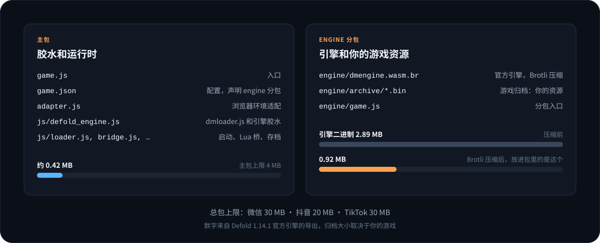
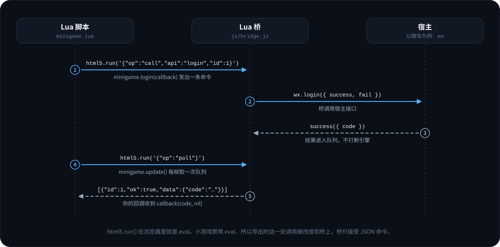

# Defold Mini Game 使用指南

本文覆盖导出工具的全部选项、三个平台的差异，以及存档、音频、输入、画面、网络、包体这些运行时行为。第一次使用请先看[快速开始](QUICK_START_zh.md)。

> [!WARNING]
> v0.1.0 是实验版。启动、渲染、触摸、存档、分包和 Lua SDK 已经用真实引擎在三个平台上跑过：微信、抖音开发者工具的模拟器，以及微信、抖音、TikTok 的 iPhone 和 Android 真机；声音在微信和抖音上跑过。跑的是仓库自带的测试应用，文中其余的运行时行为来自代码和模拟宿主测试。[兼容性清单](#14-兼容性清单)里标了“未验证”的功能要自己测。

## 1. 环境准备

- **Node.js 20 或更高**。导出工具没有 npm 依赖。
- **Defold**。已核对的版本是 1.14.0 和 1.14.1，其它版本见[支持的 Defold 版本](#15-支持的-defold-版本)。
- **平台开发者工具**：微信开发者工具、抖音开发者工具，或 TikTok 的 `ttmg`（需要 TikTok 43.4.0 以上的客户端）。
- **LuaJIT**（可选）。只有运行本仓库的 Lua 联调测试时才需要。

## 2. 打 HTML5 包

导出工具的输入是 Defold 写出的 HTML5 包，它自己不构建工程。

**用编辑器**：`Project > Bundle > HTML5 Application`，架构保留 `wasm-web`，Variant 选 Release。

**用命令行**（需要 bob.jar 和 Defold 手册要求的 JDK，1.14 是 OpenJDK 25）：

```bash
java -jar bob.jar --root . --archive --platform wasm-web --architectures wasm-web \
  --variant release --bundle-output ./bundle resolve build bundle
```

导出工具的 `build` 子命令会替你执行上面这条命令，见下一节。

对工程的要求：

| 设置 | 要求 | 原因 |
|---|---|---|
| 架构 | 包含 `wasm-web` | 小游戏没有 WebAssembly 线程，线程版引擎会被忽略 |
| `shader.exclude_gles_sm100` | 要支持 iOS 15.2 以下就设为 `0` | 引擎在老 iOS 上退回 WebGL1，需要 WebGL1 着色器。Defold 1.14.1 起默认不打包 |
| `html5.heap_size` | 按游戏实际内存设置 | 默认 256 MB，对低端机偏大，也可以在导出时用 `--heap-size` 覆盖 |
| `display.high_dpi` | 按需 | 决定画布是否使用设备像素比，见[画面](#10-画面与分辨率) |

## 3. 导出命令

```bash
node bin/defold-minigame.mjs export  --bundle <目录> --platform <平台> --appid <id> --output <目录> [选项]
node bin/defold-minigame.mjs build   --project <目录> --bob <bob.jar> --platform <平台> --appid <id> --output <目录> [选项]
node bin/defold-minigame.mjs inspect --bundle <目录>
```

- `export`：转换一个已有的 HTML5 包。
- `build`：先用 bob.jar 把工程打成 HTML5 包，再导出。需要 `--project`、`--bob`，可用 `--java` 指定 java 可执行文件，`--variant` 指定 `release` 或 `debug`。
- `inspect`：只读地报告一个包的引擎版本、包体、WebAssembly 特性和能否导出。

退出码：`0` 成功，`1` 导出被拒绝（会同时打印原因和提示），`2` 命令行用法错误。

### 必填参数

| 参数 | 说明 |
|---|---|
| `--platform` | `wechat`、`douyin` 或 `tiktok`。一次导出只针对一个平台 |
| `--appid` | 平台后台的 App ID；TikTok 填 Client Key |
| `--output` | 输出目录。必须为空，或是本工具导出过的目录；不能和 HTML5 包互相包含 |

### 可选参数

| 参数 | 默认值 | 说明 |
|---|---|---|
| `--name` | 包的可执行名 | 开发者工具里显示的工程名 |
| `--orientation` | `auto` | `portrait`、`landscape`、`auto`。`auto` 比较 `display.width` 和 `display.height` |
| `--heap-size <MB>` | 工程的 `html5.heap_size` | WebAssembly 初始堆大小，32 到 2048 |
| `--pixel-ratio <auto\|数值>` | `auto` | 画布像素比。`auto` 在开了 `display.high_dpi` 时取设备像素比，否则为 1 |
| `--max-pixel-ratio <数值>` | 工程的 `html5.max_pixel_ratio`，没有设置时是 `2` | `auto` 模式下像素比的上限 |
| `--engine-audio <auto\|on\|off>` | `auto` | 是否让引擎混音器出声。`auto` 在 TikTok 上关闭 |
| `--persistence <auto\|fs\|storage\|off>` | `auto` | 存档写到哪里。`auto` 在 TikTok 上用键值存储，其它平台用文件 |
| `--assets <目录>` | 无 | 把一个目录里的散文件原样放进包的 `assets/`，算在主包里 |
| `--subpackage <名字>=<目录>` | 无 | 把一个目录做成分包，游戏用 `minigame.load_subpackage("<名字>")` 加载；可重复。见[包体与分包](#12-包体与分包) |
| `--loading-text <文字>` | 平台默认 | 启动时宿主加载提示的文字，传空字符串则不显示 |
| `--engine-arg <参数>` | 无 | 追加引擎启动参数，可重复 |
| `--total-limit-mb <MB>` | 平台上限 | 覆盖总包上限，比如抖音开通虚拟支付后是 30 |
| `--no-brotli` | 关 | 引擎二进制不压缩 |
| `--allow-wasm-feature <名称>` | 无 | 引擎用了被拦截的 WebAssembly 特性时仍然导出，可重复 |
| `--allow-missing-bridge` | 关 | 引擎胶水里找不到 `eval` 调用时仍然导出，这时 Lua SDK 不可用 |
| `--force` | 关 | 输出目录里本工具的文件被手工改过时，仍然覆盖；工程配置文件也恢复成导出的版本 |
| `--json` | 关 | 以 JSON 输出结果 |

## 4. 导出产物



```text
<output>/
├── .defold-mini-game-export.json   所有权清单：每个文件的大小和 SHA-256
├── game.js                         平台入口
├── game.json                       平台配置：屏幕方向、分包
├── project.config.json             开发者工具的工程配置
├── project.private.config.json     仅微信
├── adapter.js                      DOM、输入、音频、网络适配层
├── js/
│   ├── boot_config.js              本次导出的参数
│   ├── platform_runtime.js         wx / tt / TTMinis.game 的选择和能力检测
│   ├── loader.js                   加载分包、读归档、启动引擎
│   ├── idb_store.js                存档用的 IndexedDB 实现
│   ├── bridge.js                   Lua 与宿主之间的桥
│   └── defold_engine.js            你的 dmloader.js 和引擎胶水，放在一个作用域模块里
├── engine/                         分包 engine
│   ├── game.js                     占位
│   ├── dmengine.wasm.br            引擎二进制，Brotli 压缩
│   └── archive/*.bin               游戏归档
├── assets/                         只有传了 --assets 才有
└── <名字>/                         每个 --subpackage 一个：你的文件，加一个占位的 game.js
```

主包是 `engine/` 和你自己的分包之外的全部内容。用 Defold 1.14.1 官方引擎时主包约 0.42 MB。

归档文件名后面多出的 `.bin` 是有意的：微信只上传白名单扩展名的文件，`.arcd`、`.arci`、`.dmanifest`、`.projectc`、`.der` 都不在名单里。

## 5. 三个平台

| | 微信 | 抖音 | TikTok Native |
|---|---|---|---|
| 运行时 API | `wx` | `tt` | `TTMinis.game` |
| WebAssembly 接口 | `WXWebAssembly` | `TTWebAssembly` | `TTWebAssembly` |
| `game.json` 分包字段 | `subpackages` | `subPackages` | `subpackages` |
| 主包上限 | 4 MB | 4 MB | 4 MB |
| 总包上限 | 30 MB | 20 MB（开通虚拟支付后 30 MB） | 30 MB |
| 存档后端 | 文件 | 文件 | 键值存储 |
| 引擎声音 | 开 | 开 | 默认关 |
| 加载提示文字 | 加载中 | 加载中 | Loading |
| 开发者工具 | 微信开发者工具 | 抖音开发者工具 | `ttmg` |

TikTok 不是抖音的别名。两者入口、配置和运行时命名空间都不同，TikTok 宿主还会同时暴露 `wx` 和 `tt` 两个兼容别名，运行时遇到 `TTMinis.game` 时一律按 TikTok 处理。

TikTok 上有两件事和另外两个平台不同，都来自 [godot_for_minigame](https://github.com/AnranS/godot_for_minigame) 的真机经验：

- 写文件系统和调用 `getStorageInfoSync` 可能让客户端直接退出，所以存档走键值存储，Lua 桥也屏蔽了这几个接口。
- 引擎混音器的播放方式曾让客户端崩溃，所以默认不给引擎提供 AudioContext。

第三件来自本项目自己在 iPhone 和 Android 手机上的运行：TikTok 没有 `onShareAppMessage`，不能预设分享菜单的内容。`minigame.set_share_content()` 在那里返回 `false` 和原因，要分享就调用 `minigame.share()`。

## 6. Lua SDK



### 接入

1. 把本仓库加为库依赖，执行 **Project > Fetch Libraries**。`game.project` 的 Dependencies 里填发布版本的地址，版本要和导出工具一致：

   ```text
   https://github.com/AnranS/defold_for_minigame/archive/refs/tags/v0.1.0.zip
   ```

2. 把 `/minigame/minigame.go` 放进启动 collection。它在 `init` 里查找桥，在 `update` 里派发异步结果。不想加这个对象，就在自己的脚本里每帧调用一次 `minigame.update()`。回调里要用 `gui.*` 的 GUI 脚本，还需要在自己的 `update()` 里调用 `minigame.update()`，原因见下一小节。
3. `local minigame = require "minigame.minigame"`。

### 回调约定

第一个参数是结果，失败时为 `nil`；最后一个参数是错误信息，成功时为 `nil`。

回调在调用 `minigame.update()` 的那个脚本里执行。这一点很重要，因为 `gui.*`、用相对地址的 `go.*`、`msg.post(".")` 都作用在“正在运行的脚本”上：

- 自己调用 `minigame.update()` 的脚本，只收到自己发起的调用的结果。
- 从不调用它的脚本，由调用它的脚本代为派发，通常就是 `/minigame/minigame.go`。

所以，回调里要操作界面节点的 GUI 脚本，应当在自己的 `update()` 里调用 `minigame.update()`；否则回调会报 “Node used in the wrong scene”。游戏对象脚本的回调如果只是改变量、给绝对地址发消息，有 `minigame.go` 就够了。

### 日志

引擎的 release 版会丢弃 `print()`。`minigame.log(message, level)` 在任何构建里都会写到宿主的控制台，`level` 取 `"info"`、`"warn"` 或 `"error"`。模块自己的警告（比如回调里抛了错）也写到那里。

### 常用功能

```lua
-- 登录：把 code 发给自己的服务器
minigame.login(function(code, err) ... end)

-- 键值存储：存小字符串
minigame.storage_set("level", "5")
local level = minigame.storage_get("level", "1")

-- 原生界面
minigame.show_toast("已保存", { icon = "success" })
minigame.show_modal({ title = "退出", content = "确定退出吗？" }, function(confirmed) ... end)

-- 分享：提前设置右上角菜单分享出去的内容（TikTok 没有这个接口，那里用 minigame.share()）
minigame.set_share_content({ title = "来和我一起玩", query = "from=share" })

-- 生命周期
minigame.on_hide(function() sys.save(save_file, state) end)

-- 安全区和胶囊按钮
local safe = minigame.get_safe_area()
local capsule = minigame.get_menu_button_rect()
```

### 激励视频

```lua
local ad = minigame.create_rewarded_video_ad("adunit-xxxxxxxx")
ad:show(function(ended, err)
    if ended then
        give_reward()
    end
end)
```

### 支付

```lua
minigame.request_payment(options, function(paid, err) ... end)
```

`options` 原样传给宿主，三个平台的字段完全不同，请按各自的支付文档填写：

| 平台 | 实际调用 |
|---|---|
| 微信 | `wx.requestMidasPayment` |
| 抖音 | `tt.requestGamePayment` |
| TikTok | `TTMinis.game.pay` |

### 没有封装的接口

任何宿主接口都可以直接调用，不需要等封装：

```lua
-- 异步接口：success / fail 变成一个回调
minigame.call("getSetting", {}, function(result, err) ... end)

-- 同步接口：位置参数
local info = minigame.call_sync("getAccountInfoSync")

-- 事件
local id = minigame.on("onMemoryWarning", function(event) ... end)
minigame.off(id)

-- 返回对象的接口
local banner = minigame.create("createBannerAd", { adUnitId = "...", style = { left = 0, top = 0, width = 300 } })
banner:invoke("show")
banner:destroy()
```

调用前可以用 `minigame.has("接口名")` 判断宿主有没有这个接口。

### 不在小游戏里

在编辑器、桌面端、普通 HTML5 包里，`minigame.is_available()` 返回 `false`，取值函数返回默认值，回调立即收到 `"not running in a mini game"`。不需要给 SDK 调用套平台判断。

### `html5.run()`

小游戏禁用 `eval`，所以 `html5.run()` 不能执行 JavaScript。导出时引擎里这一处 `eval` 被改接到 Lua 桥上，只接受 `minigame` 模块发出的命令；传别的字符串会得到一个 Lua 错误，说明原因。

完整列表见 [Lua SDK 参考](API_zh.md)。

## 7. 存档

`sys.save()`、`sys.load()` 和 `io.*` 写到 Defold 的持久目录，用法和其它平台一样，不需要改代码。

背后的过程：引擎把这个目录挂成 Emscripten 的 IDBFS，IDBFS 把它镜像到 IndexedDB。小游戏没有 IndexedDB，运行时提供了 IDBFS 用到的那一小部分接口，数据落到宿主的存储里：

| 后端 | 用在 | 落在哪里 | 注意 |
|---|---|---|---|
| `fs` | 微信、抖音 | `USER_DATA_PATH/defold-minigame/idb/` 下每个文件一个 `.bin`，加一个 `index.json` | 受宿主用户目录容量限制 |
| `storage` | TikTok | 键值存储，内容 base64 编码 | 宿主限制单个键的大小，存档要小 |
| `memory` | `--persistence off`，或宿主两种都不支持 | 只在内存里 | 重启后丢失，启动时会打警告 |

存档在引擎调用 `main` 之前恢复，所以游戏第一帧就能 `sys.load()` 到上次的数据。

游戏归档不进持久目录。每次启动从包里读进内存，更新游戏后不会读到旧资源。

## 8. 音频

Defold 在 WebAssembly 里混音，把混好的每一小块音频通过 WebAudio 播放。

| 平台 | 引擎混音器 | 用到的宿主接口 |
|---|---|---|
| 微信 | 开 | `wx.createWebAudioContext()` |
| 抖音 | 开 | `tt.getAudioContext()` |
| TikTok | 默认关 | 无 |

游戏切到后台时混音器的 AudioContext 会被挂起，回到前台时恢复。

**TikTok**：引擎找不到 AudioContext 时会静音运行，`sound.play()` 不报错但没有声音。可以用 `minigame.has_engine_audio()` 判断，然后改用宿主播放器：

```lua
if not minigame.has_engine_audio() then
    local bgm = minigame.inner_audio("assets/audio/bgm.mp3", { loop = true })
    bgm:play()
end
```

音频文件要是包里的散文件，用 `--assets` 带进去：

```bash
node bin/defold-minigame.mjs export ... --assets ./minigame_assets
# ./minigame_assets/audio/bgm.mp3 → 包里的 assets/audio/bgm.mp3
```

`--assets` 的文件算在 4 MB 的主包里。音频多的话放进[自己的分包](#自己的分包)。

`--engine-audio on` 可以在 TikTok 上强行打开引擎混音器。这个组合没有验证过，而且同样的播放方式在 godot_for_minigame 的真机测试里让客户端崩溃过。

## 9. 输入

**触摸**：宿主的触摸事件按原样转给引擎，多点触控可用。引擎自己把第一个触点当作鼠标左键，所以绑定了 `MOUSE_BUTTON_LEFT` 的动作照常工作。

**文本输入**：`gui.show_keyboard()` 会打开宿主的键盘。宿主每次回报输入框的完整文本，运行时把它和上一次的差异还原成按键：新增的字符变成字符输入，删掉的字符变成退格，确认变成回车。游戏照常在 `on_input` 里接收 `action.text`。这是基础实现，不支持在文本中间移动光标。

**物理键盘和手柄**：小游戏没有。

## 10. 画面与分辨率

- **像素比**：没开 `display.high_dpi` 时画布按 1 倍逻辑像素创建，高分屏上会偏糊；开了以后取设备像素比，并受工程的 `html5.min_pixel_ratio` 和 `html5.max_pixel_ratio` 约束，工程没有设上限时上限是 2。用 `--pixel-ratio` 可以固定一个值，用 `--max-pixel-ratio` 可以改上限。像素比越高越清晰，填充压力也越大。`window.get_display_scale()` 返回的就是这个值。
- **屏幕方向**：写在 `game.json` 里，运行时不能切换。
- **窗口变化**：宿主通知窗口尺寸变化后画布随之调整，引擎在下一帧发现并处理。
- **安全区**：用 `minigame.get_safe_area()` 和 `minigame.get_menu_button_rect()` 避开刘海和右上角的胶囊按钮。
- **WebGL 版本**：引擎先要 WebGL2，拿不到就退到 WebGL1。iOS 15.2 以下引擎自己会直接用 WebGL1。微信的文档建议 iOS 15.5 以下不要用 WebGL2。

## 11. 网络

`http.request()` 走宿主的 `request` 接口。上线前要把用到的域名加进各平台后台的 request 合法域名；开发者工具里可以先关掉域名校验。

WebSocket 走宿主的 `connectSocket`。它供带 WebSocket 的原生扩展使用，这条路径没有验证过。

## 12. 包体与分包

导出时会按平台上限检查主包和总包，超了就拒绝导出并说明超了多少。

| 部分 | 位置 | 大小（Defold 1.14.1 官方引擎） |
|---|---|---|
| 引擎胶水、加载器、适配层 | 主包 | 约 0.42 MB |
| 引擎二进制 | `engine` 分包 | 2.89 MB，Brotli 压缩后 0.92 MB |
| 游戏归档 | `engine` 分包 | 取决于游戏 |

| `--assets` 的文件 | 主包 | 取决于游戏 |
| `--subpackage` 的文件 | 各自的分包 | 取决于游戏 |

归档目前只能放在包里，不能从 CDN 加载。超过总包上限时，只能减小归档：压缩纹理，裁掉不用的资源，或用 Defold 的 Live Update 把内容拆出去（Live Update 在小游戏里没有验证过）。

### 自己的分包

游戏按路径读取的散文件（音频、图片、数据）可以做成分包。分包不占主包的 4 MB，启动时也不下载，游戏要用的时候再加载。

```bash
node bin/defold-minigame.mjs export ... \
  --subpackage levels=./minigame_levels \
  --subpackage voices=./minigame_voices
# ./minigame_levels/boss.mp3 → 包里的 levels/boss.mp3，属于分包 levels
```

导出时，每个目录被复制到包里以分包名命名的文件夹下，并在 `game.json` 里按平台的字段（`subpackages` 或 `subPackages`）声明。宿主加载分包时会执行分包根目录的 `game.js`，目录里没有的话导出工具会放一个空的。

在游戏里：

```lua
minigame.load_subpackage("levels", function(loaded, err)
    if not loaded then
        print("levels did not load:", err)
        return
    end
    local bgm = minigame.inner_audio("levels/boss.mp3", { loop = true })
    bgm:play()
end, function(percent)
    print("levels", percent, "%")
end)
```

- 加载完成之前，分包里的文件不存在；加载之后，路径就是 `分包名/文件`。对已经加载过的分包再调用一次会直接成功。
- `minigame.info().subpackages` 是这次导出声明的分包名列表。加载一个没有声明的名字，宿主会拒绝，错误信息通过回调给到你。
- 分包名以字母开头，只能用字母、数字、`-` 和 `_`，最多 32 个字符，不能是导出工具自己用的名字（`engine`、`js`、`assets`）。
- 分包计入总包上限，不计入主包。微信对单个普通分包的大小没有限制；抖音单个分包不能超过总包上限。
- 隐藏文件（以 `.` 开头）不会被复制。扩展名不在微信上传白名单里的文件会给出警告，开发者工具上传时可能丢掉它们。
- 分包里只能放游戏自己按路径读的文件。Defold 归档里的内容（collection、图集、脚本）由引擎在启动时整体读入，不能拆进分包。

这条路径已经在微信开发者工具和抖音开发者工具里用 API 功能测试应用验证过：加载分包、读取其中的文本文件、播放其中的音频。TikTok 上，分包的加载在 iPhone 和 Android 手机上通过了；那里游戏不能直接访问文件系统，分包里的文件要通过 `minigame.inner_audio()` 这样的宿主接口使用。

**内存**：WebAssembly 初始堆取工程的 `html5.heap_size`，默认 256 MB。微信 iOS 高性能模式的内存上限是 1 GB 或 1.4 GB，低端机更紧，建议按游戏实际占用设一个较小的值。

## 13. 重复导出

向同一个目录重复导出是安全的。

- 全部文件先在输出目录旁边的暂存目录里生成并校验，然后在锁内替换。
- 工具只替换自己拥有的顶层路径：`game.js`、`game.json`、`project.config.json`、`project.private.config.json`、`adapter.js`、`js/`、`engine/`、`assets/`、你声明的分包目录和清单文件。目录里其它名字的文件和文件夹原样保留。不再声明的分包，它的目录会在下一次导出时删掉。
- 这些路径里的文件如果被手工改过，或者多了不认识的文件，导出会停下并列出它们。确认要丢弃这些改动再加 `--force`。
- 两个工程配置文件是例外。它们由导出创建，之后归开发者工具：抖音开发者工具打开工程时就会重写 `project.config.json`，你在工具里改的工程设置也存在这里。再次导出会保留文件里已有的内容，只同步 App ID 和工程类型；传了 `--name` 时也同步工程名。加 `--force` 则恢复成导出的版本。
- 导出失败时，上一次的导出保持不变。
- 如果进程在替换过程中被杀掉，输出目录旁边会留下 `.lock`、`.staging-*` 或 `.backup-*`。下一次导出会停下并报告这些路径，由你比对后再清理。

## 14. 兼容性清单

| 功能 | 状态 |
|---|---|
| 精灵、文字、GUI | 已在微信、抖音开发者工具和三个平台的真机上运行 |
| 粒子、瓦片地图、物理、3D | 引擎本身的功能，未验证 |
| 触摸 | 已在微信、抖音开发者工具和三个平台的真机上运行；多点触控通过模拟宿主测试 |
| `sys.save` / `sys.load` | 已在微信、抖音开发者工具和三个平台的真机上运行；开发者工具里重启后能读回，TikTok 上写入的是键值存储；`io.*` 通过模拟宿主测试 |
| `http.request` | 模拟宿主测试通过 |
| `gui.show_keyboard` | 模拟宿主测试通过，基础实现 |
| 引擎声音 | 微信、抖音：已在各自的开发者工具和真机上运行；TikTok：默认关闭 |
| `minigame` 模块 | API 功能测试应用的自动项在微信、抖音的开发者工具和真机上全部通过；在 TikTok 真机上只有 `set_share_content` 一项失败，那里没有这个接口。登录、弹窗、剪贴板、分享、广告、支付需要人点，没有运行记录 |
| 自己的分包（`--subpackage`） | 已在微信、抖音的开发者工具和真机上运行：加载、读文件、播放音频；TikTok 真机上加载通过，读文件在那里不可用 |
| `html5.run` 执行 JavaScript | 不支持 |
| WebAssembly 线程、SIMD、异常 | 不支持，导出时拦截 |
| 带 JS 库的原生扩展 | 未验证 |
| Live Update | 未验证 |
| 物理键盘、手柄、全屏切换、指针锁定 | 小游戏没有 |
| 编辑器热重载 | 不支持，HTML5 构建本来也没有 |

## 15. 支持的 Defold 版本

导出时不按版本号放行，而是检查 `dmloader.js` 和引擎胶水是否有预期的结构。结构对不上就停下并列出缺失项，这通常意味着 Defold 改了 HTML5 加载器，需要更新本工具。

这不是假设：Defold 1.14.1 把加载器的启动流程整个重写了。1.14.0 及以前，归档和引擎各自就绪后都去调用 `Module._preloadAndCallMain()`；1.14.1 起由 `GameStartup` 统一编排。导出工具能识别这两种设计，运行时对它们各有一条启动路径。

| Defold | 加载器设计 | 状态 |
|---|---|---|
| 1.14.1 | 会话式（`GameStartup`） | 静态核对通过，模拟宿主测试覆盖，已在微信、抖音开发者工具里运行，并在微信、抖音、TikTok 的 iPhone 和 Android 手机上运行 |
| 1.14.0 | 旧式（`_preloadAndCallMain`） | 静态核对通过，模拟宿主测试覆盖 |

[`support-matrix.json`](../support-matrix.json) 记录了核对过的版本和每个版本做到了哪一级验证。不在表里的版本可以导出，导出结果里会有一条警告。

核对一个新的 Defold 版本（只下载、解析和编译，不执行引擎）：

```bash
node scripts/verify_engine.mjs --version 1.14.1                       # 当前稳定版，SHA1 自动查询
node scripts/verify_engine.mjs --version 1.14.0 --sha1 d295ed4edff2e49072719835713e625f409849f1
node scripts/verify_engine.mjs --version 1.14.2 --sha1 <sha1> --channel alpha  # 预发布版
```

想在没装 Defold 的机器上用真实引擎试一次，可以用 `scripts/fetch_example_bundle.mjs` 把 defold.com 上的一个示例拼成 HTML5 包，再用 `scripts/devtools_probe.mjs` 采集它在微信或抖音开发者工具里运行时的控制台日志和画面。两者的用法见[发布流程](RELEASING.md)。

## 16. 常见问题

**导出时说引擎用了 SIMD、线程或异常。**
你的引擎是带这些特性构建的，通常是自定义引擎或选了线程版架构。换回 `wasm-web` 的普通构建。确实要试的话用 `--allow-wasm-feature`，但宿主很可能加载不了。

**导出时说 `dmloader.js does not match the layout`。**
这个 Defold 版本改了加载器的结构。请带上 Defold 版本号反馈。

**开发者工具里 `loadSubpackage` 失败。**
确认导入的是整个输出目录，并且工程类型是小游戏。微信的游客模式不支持分包，要填真实的 App ID。如果失败的是你自己的分包，确认这个名字在导出时用 `--subpackage` 声明过，`minigame.info().subpackages` 里能看到它。

**抖音开发者工具打开过工程之后，再导出会不会被拦下？**
不会。工具会重写 `project.config.json`，导出把这个文件当作开发者工具的文件对待，见[重复导出](#13-重复导出)。

**游戏启动了但是黑屏。**
先看控制台有没有着色器错误。在老 iOS 上黑屏通常是没有打包 WebGL1 着色器，见[第 2 节](#2-打-html5-包)。

**TikTok 上没有声音。**
这是默认行为，见[第 8 节](#8-音频)。

**更新游戏后存档还在吗？**
在。存档和游戏归档分开存放，重新导出不影响存档。

**能直接在 Defold 编辑器里导出吗？**
目前不能，只有命令行工具。

**启动日志说某个归档文件在包里是 N 字节，而导出时记录的是 M。**
开发者工具正在用新旧混杂的文件运行，工程开着的时候重新导出就会这样。重新编译一次，或者清掉开发者工具的编译缓存。加载器之所以逐字节核对大小，就是为了让这种情况变成一条明确的报错。

**控制台里看不到 `print()` 的输出。**
引擎的 release 版会丢弃它。请用 `minigame.log()`，或者开发时打 debug 版的包。

**回调报 “Node used in the wrong scene”。**
GUI 的回调被派发时，正在运行的是别的脚本。在这个 GUI 脚本自己的 `update()` 里调用 `minigame.update()`，见[第 6 节](#6-lua-sdk)。

**引擎报 “Unable to get a valid shader”。**
引擎选了 WebGL 1，而包里没有 WebGL 1 的着色器，见[第 2 节](#2-打-html5-包)。在开发者工具里不应该出现这种情况：适配层不会把模拟机型的系统版本当真。

**游戏在开发者工具里每秒只有一帧左右。**
开发者工具的窗口在后台或者被挡住了，模拟器在这种情况下会被限速。把窗口切到前台。
